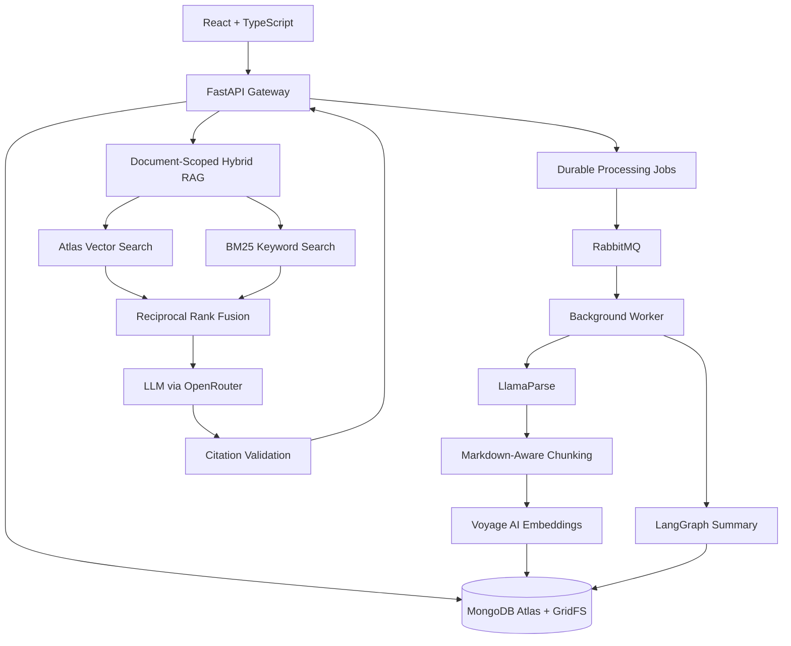

# ResearchAI — AI-Powered Research Paper Assistant

**Understand research papers faster. Ask questions with confidence. Verify answers against their sources.**

ResearchAI is a full-stack research assistant that converts academic PDFs into structured summaries and supports document-grounded conversations with navigable citations. It combines **Hybrid Retrieval-Augmented Generation (RAG)**, stateful AI workflows, and asynchronous document processing in a responsive research workspace.

[](https://www.python.org/)
[](https://fastapi.tiangolo.com/)
[](https://react.dev/)
[](https://www.mongodb.com/atlas)
[](https://www.docker.com/)

[Architecture](docs/architecture.md) · [Demo Guide](docs/demo-guide.md) · [Evaluation](evaluation/README.md) · [Deployment](docs/deployment.md)

## Why ResearchAI?

Research papers contain dense methodologies, experiments, and specialized terminology. Generic AI chat interfaces can help explain them, but answers may lack traceable support from the original document. ResearchAI focuses on **source-grounded understanding**: users can upload a paper, read a consistent summary, ask questions, and open cited evidence directly in the PDF.

## Key Features

- **Five-part research summaries:** Title/authors/abstract, problem and motivation, methodology, results, and conclusions/future work.
- **Hybrid RAG:** Voyage AI embeddings and MongoDB Atlas Vector Search combined with BM25 keyword retrieval through Reciprocal Rank Fusion (RRF).
- **Evidence-aware answers:** Document-scoped retrieval, source-reference validation, and an abstention path when evidence is insufficient.
- **Interactive citations:** Open the original PDF at the referenced page, with text/region highlighting when available and page-only fallback otherwise.
- **Background processing:** RabbitMQ workers handle PDF parsing, chunking, embeddings, and summaries with retry and recovery mechanisms.
- **Research workspace:** PDF upload, document search, status tracking, filtering, sorting, deletion, and saved conversations.
- **Offline RAG evaluation:** Ragas metrics and manual source reviews for answer and retrieval quality.

## System Architecture



### Document Processing

1. **Validate and store:** Check uploaded PDFs and identify exact duplicates using SHA-256; store originals in GridFS.
2. **Extract:** Parse page-aware Markdown and source information using LlamaParse.
3. **Chunk:** Split content with heading-aware LangChain splitters while retaining page/source references.
4. **Embed:** Generate Voyage AI vectors and store versioned retrieval artifacts in MongoDB Atlas.
5. **Summarize:** Use LangGraph to generate and validate five structured sections.
6. **Answer questions:** Retrieve relevant passages through vector and BM25 search, fuse rankings, generate an answer, and validate citations.

Processing jobs run independently of normal HTTP requests. Completed intermediate artifacts can be reused in supported retries.

## Technology Stack

| Area | Technology | Purpose |
|---|---|---|
| Frontend | React, TypeScript, Vite, Tailwind CSS | Research dashboard and PDF workspace |
| Backend | Python, FastAPI, Pydantic | API endpoints and validation |
| PDF processing | LlamaParse, LangChain | Page-aware extraction and chunking |
| Embeddings | Voyage AI | Semantic representations |
| Storage and retrieval | MongoDB Atlas, GridFS, Vector Search, BM25 | PDFs, metadata, and hybrid search |
| AI orchestration | LangGraph, LangChain, OpenRouter | Summarization and question answering |
| Asynchronous processing | RabbitMQ | Background jobs and retries |
| Evaluation | Ragas, manual source review | Retrieval and answer-quality checks |
| Quality and deployment | pytest, Vitest, Playwright, Docker Compose, GitHub Actions | Testing and development workflows |

## Repository Structure

```text
Research-Assistant-for-PDFs/
├── frontend/                      # React application
├── backend/
│   ├── gateway/                   # FastAPI routes
│   ├── services/
│   │   ├── document_processor/    # Parsing, chunking, embeddings
│   │   ├── summary_service/       # LangGraph summaries
│   │   ├── rag_service/           # Retrieval and grounded QA
│   │   └── jobs/                  # Background processing
│   ├── shared/                    # Configuration and data models
│   └── tests/                     # Backend tests
├── evaluation/                    # Ragas datasets and reports
├── docs/                          # Architecture and setup guides
├── docker-compose.yml
├── .env.example
└── README.md
```

## Getting Started

**Prerequisites:** Git, Docker Desktop with Compose V2, MongoDB Atlas, and API credentials for LlamaParse, Voyage AI, and OpenRouter. For native development, use Python 3.11+ and Node.js 22+.

### 1. Clone and Configure

Run these commands from the **repository root**:

```bash
git clone https://github.com/arrathikan/Research-Assistant-for-PDFs.git
cd Research-Assistant-for-PDFs
cp .env.example .env
```

Edit `.env` with your MongoDB Atlas connection string and API keys. Select an OpenRouter model available to your account. Configure the Atlas search indexes before running hybrid retrieval; see the [Atlas Setup Guide](docs/atlas-setup.md).

**Security:** Never commit `.env`, database credentials, or API keys. External AI providers may require credits or paid access.

### 2. Run with Docker (Recommended)

```bash
docker compose up -d --build --wait
docker compose ps
```

Open **http://localhost:3000**. FastAPI documentation is available at **http://localhost:8000/docs**.

Stop the application with `docker compose down`. See the [Deployment Guide](docs/deployment.md) for more operations and troubleshooting.

### Alternative: Run Locally

Start RabbitMQ:

```bash
docker compose up -d rabbitmq
```

Start the backend from the repository root:

```bash
python3 -m venv .venv
source .venv/bin/activate
python -m pip install -r backend/requirements.txt
python -m uvicorn backend.gateway.main:app --host 127.0.0.1 --port 8000 --reload
```

In a **second terminal**, from the repository root:

```bash
source .venv/bin/activate
python -m backend.services.jobs.main run
```

In a **third terminal**, from the repository root:

```bash
cd frontend
printf 'VITE_API_BASE_URL=http://localhost:8000/api/v1\n' > .env.local
npm ci
npm run dev
```

Open the Vite address displayed in the terminal (typically **http://localhost:5173**). Use either the complete Docker setup **or** the native frontend/backend setup, not both at the same time.

## API Overview

| Method | Route | Purpose |
|---|---|---|
| `POST` | `/api/v1/documents` | Upload a PDF |
| `GET` | `/api/v1/documents/{id}/summary` | Read the saved summary |
| `GET` | `/api/v1/documents/{id}/chunks` | Read processed chunks |
| `POST` | `/api/v1/documents/{id}/chat` | Ask a paper-specific question |
| `GET` | `/api/v1/documents/{id}/chat/{conversation_id}` | Load conversation history |
| `DELETE` | `/api/v1/documents/{id}` | Delete a paper and associated records |

See the [API Guide](backend/gateway/README.md) for complete request and response contracts.

## Evaluation and Testing

RAG quality is evaluated **offline**, separately from user-facing chat, using a source-grounded benchmark that includes answerable and unanswerable questions. The evaluation considers **Context Precision, Context Recall, Faithfulness, Answer Relevancy, and Factual Correctness**. Semantic-only and hybrid retrieval can be compared, with manual checks for unsupported claims, citation quality, and false abstentions.

The results are not represented as a universal accuracy percentage. Published reports include failure cases and metric limitations; successful integration checks alone do not prove answer correctness across all research papers. See [Evaluation Methodology](evaluation/README.md) and the [QA Evaluation Report](evaluation/reports/2026-11-13-final-qa/README.md).

**Backend tests** (repository root):

```bash
PYTHONPATH=. python -m pytest backend/tests/ -q
```

**Frontend and browser checks** (`frontend/` directory):

```bash
npm ci
npm run typecheck
npm run test
npm run build
npm run test:e2e
```

GitHub Actions runs automated checks; paid provider workflows are not part of ordinary CI. See the [Final QA Report](docs/final-qa.md) for verified scope and known issues.

## Key Engineering Decisions

| Choice | Reason |
|---|---|
| Hybrid search with RRF | Balance semantic matching and precise technical terms |
| Document-scoped retrieval | Keep evidence tied to the selected paper |
| GridFS with MongoDB Atlas | Store original PDFs alongside document metadata |
| LangGraph summaries | Coordinate stateful, validated generation |
| RabbitMQ workers | Keep expensive AI processing outside request handling |
| Versioned artifacts | Reuse completed processing and support recovery |
| Citation validation | Reduce unsupported source references |
| Offline Ragas evaluation | Measure quality without increasing live chat latency |

## Current Limitations and Next Steps

ResearchAI is an **engineering project, not a production-certified research system**. Current areas for improvement include summary consistency across LLM providers, citation completeness, broader benchmarks, and production security/observability. Some free-model configurations have failed strict source-quote validation; users should confirm provider compatibility before running a demo. Critical research claims should still be checked against the original PDF.

Future work includes stronger retrieval reranking, more diverse document evaluations, cross-paper comparison, and production-grade authentication and monitoring. See the [Latest Live QA](docs/live-e2e-qa-2026-11-14.md) for specific verified limitations.

## Documentation

[Architecture](docs/architecture.md) · [Atlas Setup](docs/atlas-setup.md) · [Hybrid RAG](docs/hybrid-rag.md) · [Summarization](docs/structured-summary.md) · [PDF Citations](docs/pdf-citations.md) · [Background Jobs](docs/background-jobs.md) · [Evaluation](evaluation/README.md) · [Demo Guide](docs/demo-guide.md)

## Author

**Aravinthan Arrathikasarma**  
AI Undergraduate — University of Moratuwa, Sri Lanka  
[GitHub](https://github.com/arrathikan) · [LinkedIn](https://www.linkedin.com/in/aravinthan-arrathikasarma/)

---

*ResearchAI — Turning complex research papers into structured, source-grounded knowledge.*
