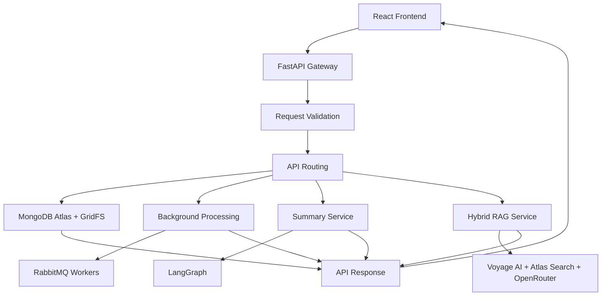

# ResearchAI — API Gateway

The **API Gateway** is the primary HTTP interface between the ResearchAI frontend and backend services. Built with **FastAPI and Pydantic**, it provides REST endpoints for document management, processing status, structured summaries, and research conversations.

The gateway centralizes request validation, API routing, error handling, and access to the application's document-processing and AI services.

## 1. Responsibilities

| Responsibility | Description |
|---|---|
| API Routing | Exposes versioned REST endpoints under `/api/v1/` |
| Request Validation | Validates incoming requests using Pydantic schemas |
| Document Management | Handles PDF upload, retrieval, and metadata |
| Processing Status | Provides document and background-job status |
| AI Integration | Connects clients to saved summaries and the Hybrid RAG chatbot |
| Error Handling | Returns consistent HTTP errors without exposing internal details |
| Logging | Records request identifiers, response status, and processing duration |
| CORS | Restricts browser access to configured origins |
| Health Checks | Provides application liveness endpoints |

The gateway separates interactive HTTP requests from computationally expensive document-processing tasks.

## 2. Architecture



The gateway exposes stable API contracts while the backend components manage document storage, processing, and AI operations.

## 3. API Endpoints

### Health and Documentation

| Method | Endpoint | Description |
|---|---|---|
| `GET` | `/health` | Application liveness check |
| `GET` | `/api/v1/health` | Versioned health response |
| `GET` | `/docs` | Interactive Swagger documentation |
| `GET` | `/openapi.json` | OpenAPI specification |

Health endpoints report **gateway liveness**, not complete readiness of MongoDB, RabbitMQ, or external AI providers.

### Document Management

| Method | Endpoint | Description |
|---|---|---|
| `POST` | `/api/v1/documents` | Upload a PDF |
| `GET` | `/api/v1/documents/{id}` | Retrieve document metadata |
| `GET` | `/api/v1/documents/{id}/status` | Retrieve document status |
| `GET` | `/api/v1/documents/{id}/pdf` | Retrieve the original PDF |
| `GET` | `/api/v1/documents/{id}/parsed` | Retrieve completed PDF extraction |
| `GET` | `/api/v1/documents/{id}/chunks` | Retrieve the active chunk set |

The upload endpoint also supports `/api/v1/documents/upload` as a compatibility alias.

### Processing and AI Services

| Method | Endpoint | Description |
|---|---|---|
| `GET` | `/api/v1/documents/{id}/processing` | Retrieve processing-job status |
| `POST` | `/api/v1/documents/{id}/processing/retry` | Retry an eligible failed job |
| `GET` | `/api/v1/documents/{id}/summary` | Retrieve a saved structured summary |
| `POST` | `/api/v1/documents/{id}/chat` | Ask a document-grounded question |
| `GET` | `/api/v1/documents/{id}/chat/{conversation_id}` | Retrieve saved conversation history |
| `POST` | `/api/v1/documents/{id}/citations/resolve` | Validate and resolve a PDF citation |
| `DELETE` | `/api/v1/documents/{id}` | Delete a document and associated data |

These routes integrate with the corresponding backend services. They do not execute offline Ragas evaluation during normal API requests.

## 4. PDF Upload and Validation

ResearchAI validates uploaded PDFs before storing them in MongoDB GridFS.

### Validation

The upload pipeline checks:

- Multipart request structure
- PDF file type and MIME information
- File size limits
- PDF structure and page validity
- Encrypted, corrupt, or empty documents
- Filename safety
- Duplicate file content using SHA-256

The default PDF upload limit is **25 MiB**, controlled through the application configuration.

### Duplicate Detection

ResearchAI calculates a SHA-256 hash from the original uploaded bytes.

If an identical file already exists, the API returns the existing document record rather than storing a duplicate.

| HTTP Status | Meaning |
|---|---|
| `201 Created` | New document uploaded |
| `200 OK` | Identical document already exists |

The response includes document metadata, duplicate status, and a message.

Document processing continues independently after upload through the configured background-job system.

## 5. Document Storage and Retrieval

Uploaded PDFs are stored in **MongoDB GridFS**, with document metadata stored in MongoDB collections.

The API supports retrieving:

- Original PDF content
- Document metadata
- Processing status
- Parsed page information
- Published document chunks
- Generated summaries

Read endpoints return previously persisted content and do not initiate additional paid parsing or generation requests.

Only complete and current processing artifacts are exposed as published results.

## 6. Error Handling

The gateway provides consistent HTTP error responses using a string `detail` field.

| Status | Description |
|---|---|
| `400` | Invalid or corrupted PDF, or malformed request |
| `404` | Requested document or resource not found |
| `409` | Resource not ready, busy, or incompatible with current processing state |
| `413` | Upload exceeds configured size limits |
| `415` | Unsupported file type or encoding |
| `422` | Request validation or identifier error |
| `500` | Unexpected internal server error |
| `503` | Required database, processing service, or provider unavailable |

Internal exception details, API credentials, and private document content are not returned in public error messages.

## 7. Logging and Request Tracking

The gateway uses structured request logging to support debugging and operational visibility.

Each request receives an `X-Request-ID` identifier.

Request logs include relevant metadata such as:

- Request identifier
- HTTP method and route
- Response status
- Processing duration

Sensitive request bodies, provider credentials, and raw internal exceptions are excluded from standard request logging.

## 8. Security and CORS

The API uses configurable Cross-Origin Resource Sharing (CORS) settings to restrict browser requests to permitted origins.

Example configuration:

```dotenv
CORS_ORIGINS=["http://localhost:5173","http://localhost:3000"]
```

The gateway also applies request validation, bounded upload sizes, and safe error handling.

**Security limitation:** CORS is not authentication. The application requires additional user authentication, document-level authorization, and production security controls before deployment as a public multi-user service.

## 9. Running Locally

Run the following commands from the repository root.

### Install Dependencies

```bash
python3 -m venv .venv
source .venv/bin/activate
python -m pip install -r backend/requirements.txt
```

### Configure Environment

```bash
cp .env.example .env
```

Set the required MongoDB connection details and provider credentials in `.env`.

### Start the Gateway

```bash
python -m uvicorn backend.gateway.main:app \
  --host 127.0.0.1 \
  --port 8000 \
  --reload
```

The gateway is available at:

- API: `http://localhost:8000`
- Swagger UI: `http://localhost:8000/docs`
- Health: `http://localhost:8000/health`

For complete Docker and worker setup, see the [main project README](../../README.md).

## 10. API Usage Examples

### Upload a PDF

```bash
curl -F "file=@/absolute/path/paper.pdf" \
  http://localhost:8000/api/v1/documents
```

### Check Document Status

```bash
curl http://localhost:8000/api/v1/documents/DOCUMENT_ID/status
```

### Retrieve the Original PDF

```bash
curl http://localhost:8000/api/v1/documents/DOCUMENT_ID/pdf \
  --output original.pdf
```

### Retrieve a Structured Summary

```bash
curl http://localhost:8000/api/v1/documents/DOCUMENT_ID/summary
```

### Ask a Research Question

```bash
curl -X POST \
  http://localhost:8000/api/v1/documents/DOCUMENT_ID/chat \
  -H "Content-Type: application/json" \
  -d '{"message":"What is the main methodology of this paper?"}'
```

Replace `DOCUMENT_ID` with the identifier returned by the upload API.

Summary and chat operations require the appropriate processing artifacts to be available.

## 11. Testing

The gateway uses pytest for API contract, validation, and integration testing.

### Backend Tests

Run from the repository root:

```bash
python -m pytest backend/tests -q
```

### Linting

```bash
ruff check backend/gateway
ruff format --check backend/gateway
```

Automated testing covers:

- Health and API response contracts
- PDF validation
- Upload and duplicate handling
- Document storage and retrieval
- Error handling
- Processing-state validation
- Backend service integration

Some integration tests require disposable MongoDB or RabbitMQ test infrastructure. Paid-provider verification is handled separately.

## 12. Engineering Decisions

| Decision | Rationale |
|---|---|
| FastAPI | Asynchronous HTTP framework with automatic API documentation |
| Pydantic | Typed request and response validation |
| Versioned API routes | Maintain consistent client contracts |
| MongoDB GridFS | Persist original PDF documents |
| SHA-256 duplicate detection | Avoid storing identical PDFs repeatedly |
| Separate background workers | Keep expensive operations outside HTTP request handling |
| Structured logging | Improve request tracing and debugging |
| Read-only result endpoints | Avoid unexpected provider calls during retrieval |
| Centralized error handling | Return consistent and safe API responses |

## 13. Limitations

- Health checks indicate gateway liveness rather than full dependency readiness.
- Original PDF retrieval does not currently provide byte-range streaming.
- External storage and AI-provider failures can affect endpoint availability.
- Document processing may remain pending while background jobs execute.
- Authentication and per-user authorization require additional implementation.
- Production deployment requires TLS, monitoring, and security hardening.

## 14. Related Documentation

- [Project Overview](../../README.md)
- [System Architecture](../../docs/architecture.md)
- [Background Processing](../../docs/background-jobs.md)
- [Structured Summarization](../../docs/structured-summary.md)
- [Hybrid RAG](../../docs/hybrid-rag.md)
- [PDF Citations](../../docs/pdf-citations.md)

---

**ResearchAI API Gateway — A consistent, validated interface for document processing and AI-powered research workflows.**
