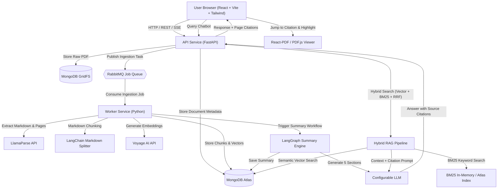
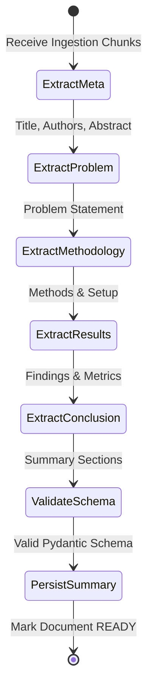

# ResearchAI System Architecture

This document provides a detailed overview of the system architecture, component boundaries, data flows, and infrastructure design for **ResearchAI — AI Research Paper Assistant**.

---

## 1. System Overview

ResearchAI is designed around modular, asynchronous services to ensure responsiveness during heavy PDF parsing, vector indexing, and multi-stage LLM generation tasks.



---

## 2. Core Components & Boundaries

### 2.1. Frontend Application
- **Stack:** React 18+, TypeScript, Vite, Tailwind CSS.
- **Responsibilities:**
  - Single-document upload interface with drag-and-drop and progress tracking.
  - Split-screen workspace: Left panel for Document Summary & Interactive Chatbot; Right panel for the interactive PDF Viewer.
  - Interactive PDF viewing via `react-pdf` / `pdf.js`, supporting page navigation, zooming, text selection, and programmatically jumping to and highlighting citations.
  - Markdown rendering for structured summaries and chat messages with clickable citation badges (e.g., `[Page 3, Section 2.1]`).

### 2.2. Core API Service (FastAPI)
- **Stack:** Python 3.11+, FastAPI, Pydantic v2, Uvicorn.
- **Responsibilities:**
  - **Upload Endpoint (`POST /api/v1/documents/upload`):** Validates PDF file type, computes SHA-256 hash, checks for duplicates, stores raw PDF into GridFS, creates document metadata record, and publishes an ingestion job to RabbitMQ.
  - **Document Status Endpoint (`GET /api/v1/documents/{id}/status`):** Real-time status reporting (`PENDING`, `PARSING`, `EMBEDDING`, `SUMMARIZING`, `READY`, `FAILED`).
  - **Document Retrieval Endpoint (`GET /api/v1/documents/{id}`):** Returns document metadata and raw PDF stream for the viewer.
  - **Summary Endpoint (`GET /api/v1/documents/{id}/summary`):** Fetches the completed 5-section structured summary.
  - **Chat / Query Endpoint (`POST /api/v1/documents/{id}/chat`):** Handles conversational queries against the document using the Hybrid RAG engine with citation generation.

### 2.3. Asynchronous Worker Service & RabbitMQ
- **Stack:** Python 3.11+, Pika / Aio-pika, RabbitMQ.
- **Queues:**
  - `document_ingestion_queue`: Triggers document parsing, chunking, and embedding.
  - `document_summary_queue`: Triggers the LangGraph summarization workflow.
  - `document_dlq`: Dead-letter queue for failed tasks with retry backoff.
- **Responsibilities:**
  - Decouples long-running LLM and parser calls from HTTP request lifecycles.
  - Ensures reliable delivery and idempotent job execution.

### 2.4. Document Ingestion & Chunking Pipeline
- **Extraction:** **LlamaParse** converts academic PDFs (including complex two-column formats, formulas, and tables) into clean Markdown while preserving page tags (`--- Page X ---`).
- **Deduplication:** **SHA-256** checksum calculated directly from uploaded file bytes. If the hash already exists in MongoDB, the upload endpoint returns the existing document record immediately.
- **Chunking:** **LangChain MarkdownHeaderTextSplitter** combined with `RecursiveCharacterTextSplitter`. Chunks respect structural headings (`#`, `##`, `###`) and retain metadata:
  - `document_id`: Parent document reference.
  - `page_number`: Extracted page number.
  - `section_title`: Current markdown header level.
  - `chunk_index`: Ordered sequence index.

### 2.5. Vector Embeddings & Hybrid Search
- **Embeddings:** **Voyage AI** (`voyage-3` or `voyage-large-2-instruct`), generating dense vectors optimized for technical and academic retrieval.
- **Vector Storage:** **MongoDB Atlas Vector Search** storing chunks and embedding vectors with HNSW indexing.
- **Keyword Search:** **BM25** index over chunk text to catch exact terminology, acronyms, author names, and formula references.
- **Hybrid Fusion:** **Reciprocal Rank Fusion (RRF)**:
  $$\text{RRF\_Score}(d) = \sum_{m \in M} \frac{1}{k + r_m(d)}$$
  Combines dense vector rank and sparse BM25 rank to ensure high recall and precision.

### 2.6. Summary Workflow Engine (LangGraph)
- **Engine:** **LangGraph** orchestrating a deterministic state graph:
  - **Node 1: Extract Metadata & Abstract:** Parses Title, Authors, and Abstract from initial chunks.
  - **Node 2: Extract Problem Statement:** Analyzes introduction and motivation sections.
  - **Node 3: Extract Methodology:** Analyzes architecture, algorithm, and experimental design sections.
  - **Node 4: Extract Key Results:** Synthesizes experimental outcomes, tables, and metric comparisons.
  - **Node 5: Extract Conclusion:** Synthesizes final conclusions, limitations, and future work.
  - **Node 6: Consolidate & Validate:** Validates schema conformity before persisting in MongoDB.



### 2.7. Conversational Hybrid RAG & Citation Engine
- **Engine:** LangChain with configurable LLM (e.g., Claude 3.5 Sonnet, GPT-4o, or Gemini 1.5 Pro).
- **Prompt Strategy:** System prompt instructs the model to only answer using provided context chunks and to cite sources using format `[Source: Page P, Chunk C]`.
- **Citation Metadata:** Every citation includes:
  - `page_number`: Exact PDF page number.
  - `quote_snippet`: Text snippet from the chunk used as evidence.
  - `chunk_id`: Unique chunk identifier in MongoDB.
- **Out-of-Scope Handling:** If question cannot be answered using the provided document, the agent responds clearly that the paper does not contain this information.

### 2.8. Ragas-Based RAG Evaluation Subsystem
- **Framework:** Ragas (modern collections-based API) paired with systematic manual cross-verification.
- **Architectural Boundary:** Strictly decoupled from live user-facing chatbot requests; executed via offline benchmarks or on-demand evaluation CLI.
- **Evaluation Trace Schema:** Every run captures:
  - `user_question`: Input query.
  - `retrieved_contexts`: List of chunk texts passed to the LLM.
  - `generated_answer`: Chatbot response.
  - `reference_answer`: Ground truth when available in curated benchmark datasets.
  - `retrieved_chunk_ids`: MongoDB chunk IDs.
  - `source_page_numbers`: Referenced PDF pages.
  - `model_configuration`: Temperature, retriever $k$, and fusion weights.
- **Component Decoupling:**
  - *Retrieval Metrics:* Context Precision, Context Recall.
  - *Generation Metrics:* Faithfulness, Answer Relevancy, Factual Correctness.
- **Comparative Benchmarking:** Quantitative comparison between Hybrid Retrieval (Vector + BM25 + RRF) and pure Semantic Vector Search on answerable and unanswerable test suites.

---

## 3. Data Schema & Models (MongoDB)

### 3.1. `documents` Collection
```json
{
  "_id": "ObjectId(...)",
  "sha256": "6b86b273ff34fce19d6b804eff5a3f5747ada4eaa22f1d49c01e52ddb7875b4b",
  "filename": "attention_is_all_you_need.pdf",
  "file_size_bytes": 2215200,
  "gridfs_file_id": "ObjectId(...)",
  "page_count": 15,
  "status": "READY", // PENDING | PARSING | EMBEDDING | SUMMARIZING | READY | FAILED
  "error_message": null,
  "created_at": "2026-11-10T11:42:00Z",
  "updated_at": "2026-11-10T11:45:00Z"
}
```

### 3.2. `chunks` Collection
```json
{
  "_id": "ObjectId(...)",
  "document_id": "ObjectId(...)",
  "chunk_index": 12,
  "page_number": 3,
  "section_title": "3.1 Scaled Dot-Product Attention",
  "content": "The two most commonly used attention functions are...",
  "embedding": [0.0123, -0.0456, "... (Voyage AI vector) ..."],
  "token_count": 340,
  "created_at": "2026-11-10T11:43:10Z"
}
```

### 3.3. `summaries` Collection
```json
{
  "_id": "ObjectId(...)",
  "document_id": "ObjectId(...)",
  "title": "Attention Is All You Need",
  "authors": ["Ashish Vaswani", "Noam Shazeer", "Niki Parmar", "..."],
  "abstract": "The dominant sequence transduction models are based on...",
  "problem_statement": "Recurrent neural networks factor computation along symbol positions...",
  "methodology": "The Transformer replaces recurrent layers with multi-head self-attention...",
  "key_results": "On the WMT 2014 English-to-German translation task, the Transformer achieves 28.4 BLEU...",
  "conclusion": "The Transformer is the first sequence transduction model based entirely on attention...",
  "generated_at": "2026-11-10T11:44:30Z"
}
```

---

## 4. Security, Secrets & Environment Strategy

1. **Zero Secret Hardcoding:** All credentials (API keys, connection URIs) are loaded through Pydantic `BaseSettings` reading from `.env`.
2. **File Size & Type Guard:** Upload endpoint strictly accepts `application/pdf` with a maximum configurable size (default: 25 MB).
3. **CORS Policy:** Strict origin checks configured for local development and production environments.
4. **Isolated Worker Processes:** Background workers operate independently from the user-facing web server to prevent compute starvation.

---

## 5. Known Limitations & Future Considerations

- **Single Document Active Session:** The system processes one document at a time per session, optimized for in-depth per-paper exploration. Multi-document cross-comparison is reserved for future extensions.
- **External Dependency Limits:** Dependent on Voyage AI and LlamaParse rate limits and quota; handled with exponential backoff and queuing via RabbitMQ.


## Gateway implementation status

The gateway now separates liveness routing and public response schemas from app
configuration. Central handlers return string `detail` errors; middleware adds
request IDs and structured duration/status logs without logging request content.
CORS is configured from environment settings. External dependencies are not yet
connected, so health responses report gateway liveness only.

## MongoDB storage foundation (Prompt 4)

PyMongo connections have bounded selection/connect/socket timeouts and explicit
cleanup. Index initialization materializes the six domain collections. Document
`_id` is a MongoDB ObjectId, serialized as a string at Python model boundaries;
related records use string `document_id` fields. `documents.sha256` is unique.
The API does not establish database connections at import time or during liveness
checks. GridFS persistence is implemented separately from HTTP upload routing.

### Original PDF persistence

`store_pdf` computes SHA-256, uploads to a unique GridFS file ID, and inserts a
validated document record. The unique hash index arbitrates races; duplicate
losers delete their own files and return the winner. Files carry document ID
and SHA-256 metadata for reconciliation. `read_pdf` resolves by document ID and
GridFS ID rather than filename. GridFS is outside metadata transactions: crashes
can leave orphan files, and uncertain inserts retain files for operator review.
No HTTP upload, parser, embeddings, or job processing is added by Prompt 4.

## Upload validation boundary (Prompt 5)

Validation reads at most the configured file limit plus one byte, strips directory
components from filenames, and verifies PDF structure/page references with pypdf.
This runs before database writes and does not extract paper text or invoke AI.
The original accepted bytes, rather than a rewritten PDF, are used for SHA-256.

### Upload API orchestration

An ASGI body counter bounds multipart requests even without Content-Length;
the parser accepts one file and no fields. The domain validator runs before
database access. A thread-pool task ensures indexes and stores the original
bytes with validated page count; concurrent duplicates use the storage layer's
unique index and loser cleanup. Responses preserve actual lifecycle status.
Metadata/status/original-PDF reads use explicit database lifecycle helpers.
No AI or message broker is invoked in this stage.

## Extraction contracts (Prompt 6)

Normalized output preserves one-based PDF page numbers, per-page Markdown and
individual source elements. Complete page coverage is checked against the
original PDF page count; ambiguous or partial output is rejected. Markdown
headings/tables remain intact and combined output has explicit page separators.
Item coordinates retain provider-defined units. Layout boxes use the provider's
documented normalized convention; unrelated layout boxes are never attached to
text. Missing or invalid coordinates fall back to page-level attribution.

The supported v2 SDK adapter converts explicitly numbered Markdown/items pages
to the internal page contract. Current item boxes are in page points, with all
boxes retained and parent/child relationships preserved. The standalone adapter
uses bounded HTTP/polling timeouts and avoids automatic paid POST retries.

### Extraction lifecycle and publication

A worker atomically claims only pending/failed documents that are neither running
nor already parsed. The original GridFS bytes are revalidated before a paid
provider call. Per-run `parsed_pages` and `source_elements` records are immutable.
Only after every write succeeds does one conditional metadata update publish
`active_parse_run_id`. Readers filter by that pointer; partial runs are invisible.

During extraction the document is PARSING with parsing_status RUNNING. Success
sets parsing_status COMPLETED and the overall status PENDING for the next stage.
It never marks the document READY before chunking/embedding/summary. Failures set
FAILED with a safe error message. Completed extraction is reused without paying
for another call. Interrupted RUNNING claims need operator review; no automatic
lease expiration can launch a duplicate paid job. Partial runs are retained for
manual reconciliation without removing previous successful output.
