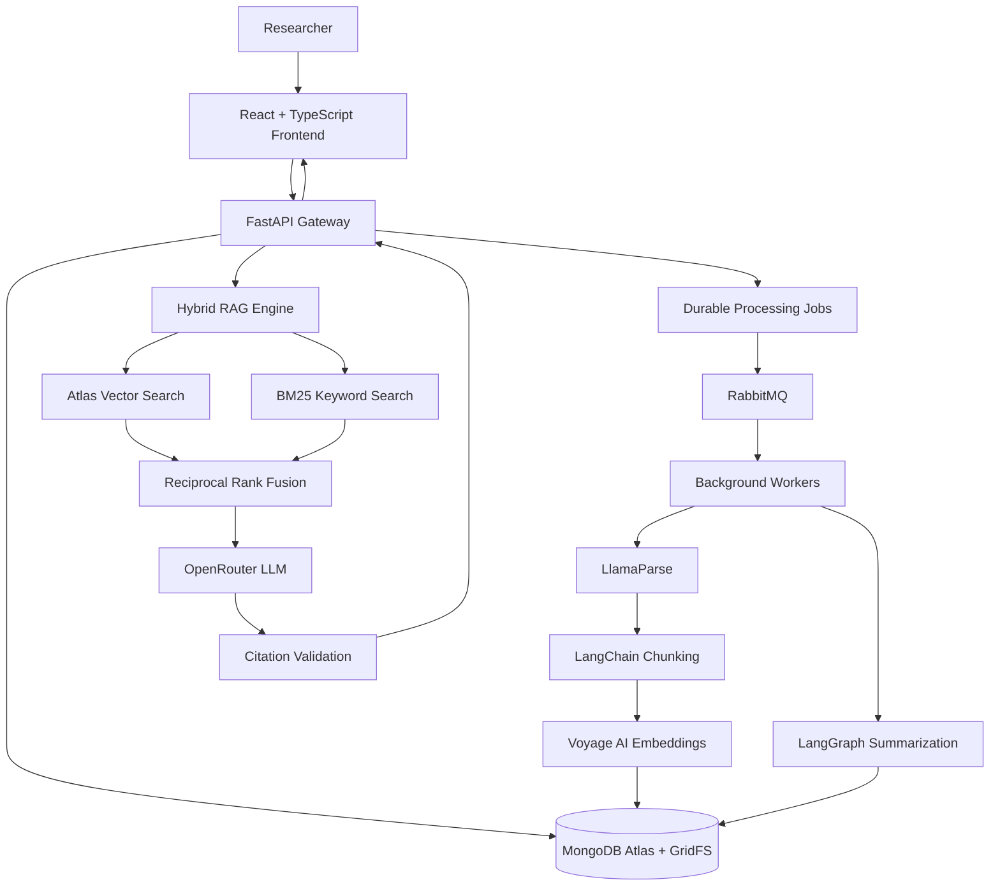
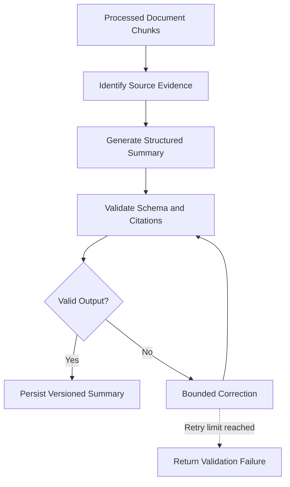
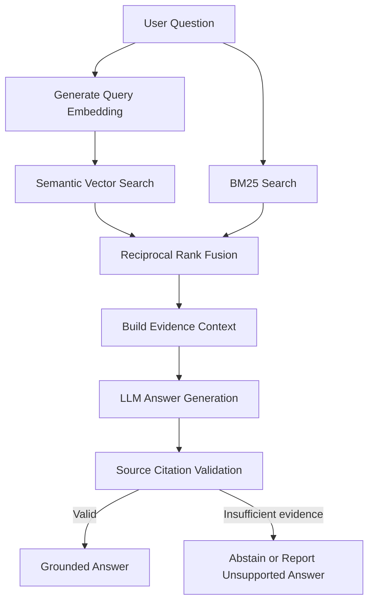

# ResearchAI — System Architecture

## 1. Overview

**ResearchAI** is an AI-powered research paper assistant designed to simplify academic document analysis through structured summarization, Hybrid Retrieval-Augmented Generation (RAG), and source-grounded question answering.

The application uses a modular, asynchronous architecture to separate user interactions from computationally intensive document processing and AI operations.

### Architecture Goals

- **Modularity:** Separate document ingestion, summarization, retrieval, and user interaction into maintainable components.
- **Reliability:** Support background processing, job recovery, and reuse of completed artifacts.
- **Accuracy:** Ground generated responses in retrieved document evidence and validate source citations.
- **Scalability:** Support concurrent document processing through independent background workers.
- **Traceability:** Preserve document versions, processing metadata, and page-level source references.
- **Maintainability:** Use clearly defined component boundaries, typed data models, and automated testing.

---

## 2. High-Level System Architecture

### Core Architectural Components

| Component | Technology | Responsibility |
|---|---|---|
| Frontend | React, TypeScript, Vite, Tailwind CSS | Research dashboard and interactive workspace |
| API Gateway | FastAPI, Pydantic | HTTP endpoints, validation, and request orchestration |
| Background Processing | RabbitMQ, Python workers | Asynchronous document processing and recovery |
| Document Extraction | LlamaParse | Page-aware PDF content extraction |
| Text Chunking | LangChain | Markdown-aware segmentation |
| Embeddings | Voyage AI | Dense vector generation |
| Storage | MongoDB Atlas, GridFS | PDFs, metadata, chunks, and generated results |
| Hybrid Retrieval | Atlas Vector Search, BM25, RRF | Relevant evidence retrieval |
| AI Orchestration | LangGraph, LangChain | Stateful summarization and question answering |
| LLM Gateway | OpenRouter | Configurable language-model access |
| PDF Viewer | React-PDF, PDF.js | Citation navigation and highlighting |
| Evaluation | Ragas | Offline retrieval and answer-quality measurement |

---

## 3. Document Processing Pipeline

The document processing pipeline transforms uploaded academic PDFs into structured, searchable research content.

### 3.1 PDF Upload and Validation

The FastAPI gateway receives document uploads and performs validation before persistence.

Validation includes:

- PDF file type and structural integrity checks.
- Configurable upload size limits.
- Filename sanitization.
- SHA-256 content-based duplicate detection.
- Rejection of corrupt, empty, or unsupported PDFs.

Accepted PDFs are stored in MongoDB GridFS, while document metadata is maintained in MongoDB collections.

A durable processing job is created to initiate asynchronous ingestion.

### 3.2 PDF Extraction

**LlamaParse** extracts structured content from uploaded research papers.

The extracted representation preserves available information such as:

- Page-aware Markdown text
- Headings and section hierarchy
- Tables and technical content
- Page numbers and source references
- Source coordinates where available

The extraction system validates page coverage and retains the original PDF as the authoritative document.

Incomplete parsing results are not published as completed document content.

### 3.3 Markdown-Aware Chunking

ResearchAI uses LangChain text splitters to divide extracted content into manageable retrieval units.

**MarkdownHeaderTextSplitter** preserves document headings and structural boundaries, while **RecursiveCharacterTextSplitter** enforces configurable chunk sizes and overlap.

Each chunk retains metadata identifying its source document, relevant sections, page references, and processing version.

This structure supports evidence-based retrieval and citation navigation.

### 3.4 Embedding Generation

Voyage AI transforms document chunks into dense numerical vectors representing semantic meaning.

Embedding generation supports:

- Separate document and query input types
- Configurable embedding models and dimensions
- Batched processing
- Validation of returned vectors
- Bounded retries for transient failures
- Reuse of cached embeddings

Generated vectors and searchable chunk snapshots are stored in MongoDB Atlas.

### 3.5 Processing Lifecycle

Document ingestion uses durable jobs with lifecycle tracking.

A document progresses through processing states such as:

`PENDING → PARSING → EMBEDDING → SUMMARIZING → READY`

Failed operations are recorded and can be handled through supported retry and recovery mechanisms.

A document is marked ready only when the required processing artifacts are complete and consistent.

---

## 4. Structured Summarization Architecture

ResearchAI uses **LangGraph** to coordinate structured research paper summarization.

The summary workflow extracts information into five predefined sections.

| Section | Purpose |
|---|---|
| Title, Authors & Abstract | Identify the paper and its research objective |
| Problem Statement & Motivation | Explain the problem addressed by the research |
| Methodology & Architecture | Describe methods, models, algorithms, and design |
| Key Results & Benchmarks | Present reported experimental findings |
| Conclusion & Future Directions | Summarize contributions, limitations, and future work |

### Workflow

The workflow uses Pydantic schemas to enforce output structure and checks supporting source references before publishing results.

For longer documents, bounded processing and reduction steps combine information while preserving supporting evidence.

Completed summaries are persisted and reused instead of regenerated for every user request.

---

## 5. Hybrid Retrieval-Augmented Generation

ResearchAI combines semantic and keyword-based retrieval to identify relevant evidence from academic documents.

### 5.1 Semantic Vector Search

Voyage AI generates a query embedding using a compatible embedding profile.

MongoDB Atlas Vector Search retrieves semantically related document passages.

This helps identify relevant content even when the wording of the user's question differs from the research paper.

### 5.2 BM25 Keyword Search

BM25 retrieves passages using lexical relevance.

This is particularly useful for exact technical terminology, model names, algorithm names, acronyms, and other specific expressions.

### 5.3 Reciprocal Rank Fusion

ResearchAI combines semantic and keyword retrieval results using **Reciprocal Rank Fusion (RRF)**.

The general scoring function is:

\[
RRF(d)=\sum_{r\in R}\frac{1}{k+\operatorname{rank}_r(d)}
\]

Where:

- \(d\) represents a retrieved document passage.
- \(R\) represents the retrieval ranking lists.
- \(k\) is the rank-fusion constant.
- \(\operatorname{rank}_r(d)\) is the position of passage \(d\) in ranking \(r\).

RRF combines both retrieval strategies without requiring their raw relevance scores to use the same scale.

### 5.4 Question Answering Workflow

Retrieval is scoped to the selected document and its active processing generation, preventing outdated or unrelated document chunks from being used as supporting evidence.

The answer-generation pipeline validates source references and handles insufficient evidence explicitly.

---

## 6. Citation and PDF Navigation

ResearchAI connects generated research responses to supporting passages in the original PDF.

The citation system retains references such as:

- Source document identity
- Chunk identity
- PDF page number
- Supporting text
- Processing generation
- Source coordinates when available

### Citation Resolution

When a user selects a citation:

1. The frontend requests the relevant source.
2. The backend validates the citation against current document evidence.
3. The PDF viewer navigates to the referenced page.
4. Matching text or verified regions are highlighted when possible.
5. If precise highlighting is unavailable, page-level navigation is provided.

The React-PDF viewer remains optional and is opened only when requested.

On desktop, the workspace supports a split layout for reading and source verification. On mobile, the PDF opens in a dedicated full-screen viewer.

---

## 7. Asynchronous Processing and Reliability

ResearchAI uses **RabbitMQ** and background workers to separate expensive document-processing tasks from interactive HTTP requests.

### Processing Architecture

The backend persists processing jobs, which are published to RabbitMQ and consumed by independent workers.

Workers execute extraction, chunking, embeddings, and summary generation.

### Reliability Mechanisms

| Mechanism | Purpose |
|---|---|
| Durable job records | Preserve processing state |
| RabbitMQ acknowledgments | Track completed message handling |
| Bounded retries | Recover from supported transient failures |
| Dead-letter handling | Preserve failed tasks for inspection |
| Idempotent processing | Reduce duplicate execution |
| Processing ownership and leases | Coordinate concurrent workers |
| Versioned artifacts | Prevent partially completed outputs from becoming active |
| Cached embeddings | Reuse previously generated vectors |
| Explicit recovery procedures | Handle interrupted or uncertain operations |

Long-running operations are executed outside the API request lifecycle.

These mechanisms improve resilience, although some interrupted or uncertain jobs still require reviewed recovery rather than automatic re-execution.

---

## 8. Data Storage Architecture

MongoDB Atlas provides the primary persistence layer.

### Main Data Categories

| Collection or Storage | Responsibility |
|---|---|
| `documents` | Document metadata and processing status |
| GridFS | Original uploaded PDF files |
| `parsed_pages` | Extracted page content |
| `source_elements` | Page-level source information |
| `chunks` | Structured document segments |
| `embedding_vectors` | Reusable embedding cache |
| `chunk_embeddings` | Searchable vector snapshots |
| `summary_runs` | Versioned summary outputs |
| `chat_conversations` | Conversation metadata |
| `chat_turns` | Saved questions and responses |
| `processing_jobs` | Durable processing jobs and scheduling state |

### Data Consistency

ResearchAI maintains active processing-version references to distinguish current artifacts from previous processing results.

New extraction, chunking, embedding, and summary artifacts are published only after their respective consistency checks.

Previous completed versions can remain available for recovery or auditing.

This design reduces the risk of exposing partially processed data.

---

## 9. RAG Evaluation Architecture

ResearchAI includes a separate evaluation subsystem based on **Ragas**.

Evaluation runs independently of normal chatbot requests.

### Evaluation Metrics

| Metric | Objective |
|---|---|
| Context Precision | Measure relevance of retrieved evidence |
| Context Recall | Measure coverage of expected evidence |
| Faithfulness | Evaluate whether responses are supported by context |
| Answer Relevancy | Assess relevance to the user's question |
| Factual Correctness | Compare responses with reference answers |

### Evaluation Process

1. Prepare source-grounded benchmark questions.
2. Execute semantic-only and hybrid retrieval strategies.
3. Generate responses using the configured RAG pipeline.
4. Evaluate applicable metrics with Ragas.
5. Review source evidence and citation correctness.
6. Save reproducible reports and document observed failures.

Evaluation reports distinguish successful measurements from skipped metrics, execution errors, and unsupported responses.

The benchmarking system provides evidence for identifying retrieval and generation weaknesses without treating a single test run as proof of overall research-answer accuracy.

See [Evaluation Documentation](../evaluation/README.md).

---

## 10. API Architecture

The FastAPI gateway exposes REST endpoints for document management, summaries, and research conversations.

| Method | Endpoint | Responsibility |
|---|---|---|
| `POST` | `/api/v1/documents` | Upload and register a PDF |
| `GET` | `/api/v1/documents/{id}` | Retrieve document metadata |
| `GET` | `/api/v1/documents/{id}/status` | Retrieve processing status |
| `GET` | `/api/v1/documents/{id}/summary` | Retrieve a saved research summary |
| `GET` | `/api/v1/documents/{id}/chunks` | Retrieve processed document chunks |
| `POST` | `/api/v1/documents/{id}/chat` | Generate a document-grounded response |
| `GET` | `/api/v1/documents/{id}/chat/{conversation_id}` | Retrieve conversation history |
| `DELETE` | `/api/v1/documents/{id}` | Delete a document and associated data |

The gateway uses Pydantic for typed validation and structured responses.

Document-processing operations remain separate from read-only retrieval endpoints.

---

## 11. Security and Configuration

The application includes several security-conscious design decisions:

- API credentials and database connection strings are configured through environment variables.
- PDF uploads undergo file-format, size, and structural validation.
- Cross-origin requests are restricted through configurable CORS policies.
- Internal processing metadata and evaluation traces are excluded from public chatbot responses.
- Database queries and AI retrieval are scoped to active document versions.
- Containerized services separate frontend, API, and background-worker responsibilities.

**Security boundary:** The current application does not provide a complete authentication and per-user authorization layer. Production deployment requires authentication, ownership-based access control, additional infrastructure hardening, and comprehensive security testing.

---

## 12. Deployment Architecture

ResearchAI supports local development and containerized execution using Docker Compose.

The containerized application includes:

- **Nginx frontend:** Serves the built React application and proxies API requests.
- **FastAPI gateway:** Handles HTTP requests and application endpoints.
- **Background workers:** Execute document processing and AI workflows.
- **RabbitMQ:** Coordinates asynchronous task delivery.
- **MongoDB Atlas:** Provides external document storage and hybrid search.

GitHub Actions performs automated backend, frontend, and Docker verification. Standard CI uses isolated test infrastructure and simulated paid-provider boundaries rather than relying on live AI calls.

See [Deployment Documentation](deployment.md) and [CI Documentation](ci.md).

---

## 13. Engineering Trade-offs

| Design Decision | Benefit | Trade-off |
|---|---|---|
| Hybrid RAG | Covers semantic and exact-term retrieval | Additional indexing and retrieval complexity |
| MongoDB Atlas | Unified document and vector-search infrastructure | Dependence on Atlas search capabilities |
| RabbitMQ | Decouples long-running workloads | Additional service and recovery complexity |
| LangGraph | Structured and validated AI workflows | More orchestration than direct LLM calls |
| Strict citation validation | Reduces unsupported citations | May reject otherwise useful responses |
| Versioned artifacts | Improves processing consistency and recovery | Additional storage and metadata management |
| External AI providers | Access to specialized parsing, embedding, and LLM services | Cost, rate limits, and provider availability |

---

## 14. Limitations and Future Improvements

ResearchAI is an actively developed system with automated test coverage and selected live integration verification.

Current limitations include:

- Summary generation can fail when an LLM does not satisfy strict source validation.
- Citation accuracy and research-answer completeness require further improvement.
- Session-oriented document management is not a substitute for persistent user accounts.
- Multi-document comparison is not currently supported.
- Production authentication, authorization, observability, and deployment hardening remain future work.

Planned improvements focus on retrieval quality, robust summarization, broader Ragas benchmarks, multi-document research capabilities, and production readiness.

---

## 15. Conclusion

ResearchAI demonstrates an end-to-end AI application architecture combining document ingestion, hybrid information retrieval, stateful LLM workflows, asynchronous job processing, and source-based answer validation.

Its main engineering focus is **building a research assistant whose outputs can be traced back to the original document**, while maintaining clear component boundaries, reusable processing artifacts, and measurable evaluation workflows.

For implementation details, configuration, and verified test results, refer to the repository's supporting technical documentation.
