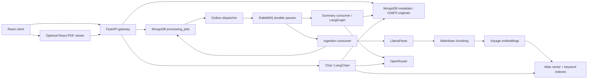

# ResearchAI architecture

ResearchAI is a React client, a FastAPI HTTP gateway and a background-worker
runtime sharing one Python codebase. Service directories are module boundaries;
they are not independently deployed HTTP microservices. MongoDB stores application
state and GridFS PDFs; RabbitMQ carries job notifications. Ragas runs separately.

## Runtime and data flow

## HTTP boundary

`backend/gateway/main.py` composes document, processing, chat, citation and health
routers. Synchronous storage work runs through synchronous route handlers or the
thread pool. Pydantic schemas validate identifiers and responses; safe errors do
not reflect private request bodies or provider messages. CORS permits configured
origins but provides no authentication or authorization.

| API under `/api/v1` | Purpose |
| --- | --- |
| `POST /documents` | Validate/store one PDF; ensure a durable processing job |
| `GET /documents/{id}` and `/status` | Metadata and actual document state |
| `GET /documents/{id}/pdf` | Original PDF bytes |
| `GET /documents/{id}/parsed`, `/chunks`, `/summary` | Published extraction, chunks and summary |
| `GET /documents/{id}/processing` | Job progress/state without invented percentages |
| `POST /documents/{id}/processing/retry` | Supported failed-job recovery |
| `POST /documents/{id}/chat` | Document-scoped question answering |
| `GET /documents/{id}/chat/{conversation_id}` | Persisted conversation history |
| `POST /documents/{id}/citations/resolve` | Revalidate a source before viewer navigation |
| `DELETE /documents/{id}` | Delete original and document-scoped records |
| `GET /health` | Gateway liveness; `/health` also exists outside `/api/v1` |

There is no account system or backend library-list endpoint. Original PDF responses
are read into memory, without byte-range streaming. See the generated `/docs`
OpenAPI page for precise request/response contracts.

## Upload and storage

The gateway accepts one multipart PDF, rejects unsupported, corrupt or encrypted
files using byte/structure checks, and caps the file at 25 MiB by default. SHA-256
and a unique metadata index deduplicate identical bytes; concurrent losing uploads
remove only their own candidate GridFS file.

Original bytes live in `fs.files` / `fs.chunks`. The `documents` record links the
original and active processing generations. Parsed pages, source elements, chunks,
embeddings and summaries are versioned rather than overwritten during generation.

| Records | Role |
| --- | --- |
| `documents`, GridFS | Identity, lifecycle, active pointers and original bytes |
| `parsed_pages`, `source_elements` | Immutable parse-run pages and optional source geometry |
| `chunks` | Heading/page-aware chunk generations |
| `embedding_vectors`, `chunk_embeddings` | Content/profile vector cache and document-scoped searchable records |
| `summary_runs` | Immutable validated summaries and generation profiles |
| `chat_conversations`, `chat_turns` | Scoped history, turn ownership and canonical citations |
| `processing_jobs` | Durable outbox, claims, attempts, leases and terminal states |

`backend/shared/database.py` initializes ordinary indexes explicitly. Other domain
modules maintain their version-specific indexes. Populated legacy chunk indexes
require a backed-up, reviewed migration; startup does not delete that data.
GridFS and metadata writes are not one transaction: ambiguous failures can leave
orphans requiring operator reconciliation. There is no automatic bulk deletion.

## Background processing

Upload stores the original and ensures a MongoDB job before returning. The worker
supervisor runs an outbox dispatcher and ingestion/summary consumers using Pika.
Confirmed publishing plus idempotent claims protects against broker redelivery.
The ingestion path parses, chunks and embeds, then schedules summary work.
Consumers use bounded retries, backoff, leases, heartbeat checks and a dead-letter
queue; paid provider failures are not reported as successful completion.

Documents become `READY` only after a current summary and configured embeddings
are complete. That state does not establish Atlas search-index queryability or
model answer quality. Interrupted provider calls can require reviewed recovery
instead of automatic takeover that might duplicate paid work. Detailed recovery
and queue contracts are in [background jobs](background-jobs.md).

## Extraction, chunking and embeddings

LlamaParse v2 uses the unified `llama-cloud` SDK and returns page-aware Markdown.
Normalization preserves all one-based pages, headings, tables, source elements and
available coordinate units. Missing coordinates are not invented. Native page
margin text is retained for publication metadata evidence.

LangChain's `MarkdownHeaderTextSplitter` separates headings, followed by
`RecursiveCharacterTextSplitter` with configurable character size/overlap
(default 1200 / 150). Splitting is page/source aware; overlap is a target, not a
guaranteed exact length. Stable chunk-set identities include source/configuration
versions. Re-chunking invalidates incompatible downstream generations.

Voyage embeds documents and queries with their respective input types. The safe
template selects `voyage-4-lite`, 1024 dimensions. Embedding profiles prevent reuse
across incompatible models/dimensions. A content/profile cache avoids repeating
unchanged document vectors. Voyage reranking is configured but not implemented.
See [chunking](markdown-chunking.md) and [hybrid retrieval](hybrid-rag.md).

## Intent-sensitive research chat

The active scope includes document, parse run, chunk set and embedding profile.
Atlas `$vectorSearch` supplies semantic candidates and `$search` text supplies
BM25 keyword candidates; LangChain runs the two branches and Python combines ranks
using RRF (default constant 60). Both indexes must be ready/queryable. The active
keyword implementation uses Atlas, not the declared `rank-bm25` Python package.

Intent rules distinguish facts, broad research questions, metadata, follow-ups,
mixed questions and general background. Metadata uses targeted extracted title-page
and page-margin evidence, not an independently verified structured author catalog.
Overview questions use bounded section-diverse context. Follow-ups receive bounded
history while preserving the literal question. General background is labeled and
must not acquire paper citations.

A LangChain composition packs context and calls OpenRouter for structured answer
selection. The server maps selected passage keys back to canonical source records;
public responses hide retrieval scores and internal traces. Stale/foreign sources
are rejected. Insufficient evidence permits abstention. Page/quote identity checks
do not establish semantic entailment of every generated claim.

## Structured summaries

`summary_service/workflow.py` builds a deterministic LangGraph with identify,
generate, validate, advance, combine and save nodes. All current chunks pass through
bounded windows; validated notes reduce through a bounded tree for long papers.
Schema/source failures can receive up to two targeted repairs by default.
Transport retries have a separate limit. No autonomous agent or model fallback
is hidden in this workflow.

The five sections are Title, Authors and Abstract; Problem Statement; Methodology;
Key Results; Conclusion. Missing facts remain explicitly unavailable. Quotes must
match current page-attributed source text. The model/schema/workflow/configuration
profile identifies immutable results; ownership and unchanged source pointers are
checked before publication. Unchanged completed results can be reused. Strict quote
validation can still reject full-paper generations; see [summary details](structured-summary.md).

## Frontend and citation navigation

`frontend/src/App.tsx` composes Dashboard, Upload and Workspace using shared
containers. The orange identity uses the supplied book-logo PNG. Library entries
are session-storage references; refresh refetches current metadata and drops
removed entries. Conversation history is server-persisted and scoped per document.
There is no cross-device account library or author/keyword catalog search.

The PDF viewer is hidden initially and lazy-loaded after an explicit request.
One viewer component supports toolbar opening and citations. The resolver checks
document, active generation, one-based page and exact quoted source. A citation
opens the viewer and navigates it; verified text/geometry can highlight the passage,
otherwise the page displays quietly. Invalid sources show a friendly error.

At desktop widths the workspace uses approximately 55:45 content/PDF columns;
mobile uses a full-screen viewer. Chat, draft, summary, page and zoom state survive
viewer toggles within a document; document changes reset scoped PDF navigation.
PDF.js worker, fonts and CMaps are copied locally from the installed version.
See [citation behavior](pdf-citations.md) and [browser QA](browser-qa.md).

## Deletion and data ownership

Deletion marks the document `DELETING` so workers and readers reject new work,
then removes scoped jobs, conversations, source generations and GridFS original.
Partial cleanup is retryable. It preserves other documents, shared indexes and
the content/profile embedding cache. Browser deletion requires confirmation.
Tests use isolated records; existing user papers are never cleanup fixtures.

## Offline evaluation

The optional `evaluation/` CLI collects real retrieval/answer traces, then uses
Ragas 0.2.15 `EvaluationDataset` / `evaluate()` for applicable faithfulness, answer
relevancy, context precision/recall and factual correctness. Paired semantic-only
and hybrid retrieval share candidate snapshots. Missing scores remain errors or
skips, not zeroes or substituted results. Normal HTTP chat never imports Ragas.

The active 20-case public-paper dataset and nine-case intent dataset include
unsupported questions and versioned review provenance. Current reviews are
assistant checks; independent human approval remains outstanding. Published
reports document incomplete runs and attribution/citation failures. They do not
establish broad accuracy or hybrid superiority. See [evaluation methodology](rag-evaluation.md).

## Deployment and boundaries

Compose runs the gateway, worker supervisor, RabbitMQ and Nginx frontend; optional
ordinary MongoDB supports local storage only. One Python image is reused across
API/worker roles. CI runs credential-free checks plus isolated real MongoDB/broker
integration and a container smoke test; paid evaluations remain opt-in.

Provider keys and database credentials stay in ignored runtime environment files,
never frontend variables, image build arguments or source control. OpenRouter is
the implemented completion gateway; alternate role names do not provide automatic
fallback or vision inference. This local/demo app needs dependency remediation,
authentication, authorization and deployment security before public multi-user use.
