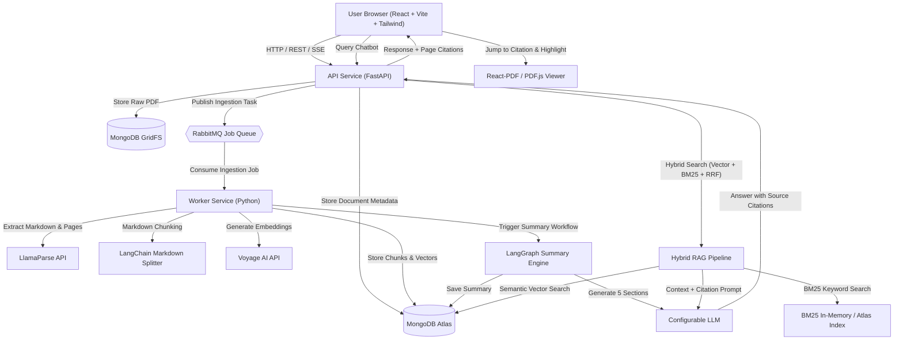
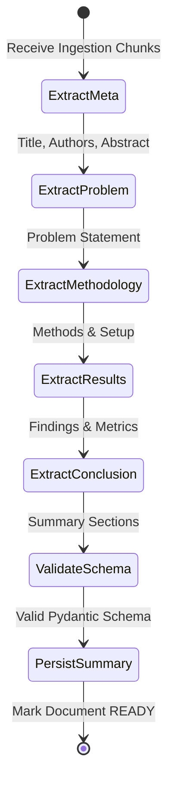

# ResearchAI System Architecture

This document provides a detailed overview of the system architecture, component boundaries, data flows, and infrastructure design for **ResearchAI — AI Research Paper Assistant**.

---

## 1. System Overview

ResearchAI is designed around modular, asynchronous services to ensure responsiveness during heavy PDF parsing, vector indexing, and multi-stage LLM generation tasks.



---

## 2. Core Components & Boundaries

### 2.1. Frontend Application
- **Stack:** React 18+, TypeScript, Vite, Tailwind CSS.
- **Responsibilities:**
  - Single-document upload interface with drag-and-drop and progress tracking.
  - Split-screen workspace: Left panel for Document Summary & Interactive Chatbot; Right panel for the interactive PDF Viewer.
  - Interactive PDF viewing via `react-pdf` / `pdf.js`, supporting page navigation, zooming, text selection, and programmatically jumping to and highlighting citations.
  - Markdown rendering for structured summaries and chat messages with clickable citation badges (e.g., `[Page 3, Section 2.1]`).

### 2.2. Core API Service (FastAPI)
- **Stack:** Python 3.11+, FastAPI, Pydantic v2, Uvicorn.
- **Responsibilities:**
  - **Upload Endpoint (`POST /api/v1/documents/upload`):** Validates PDF file type, computes SHA-256 hash, checks for duplicates, stores raw PDF into GridFS, creates document metadata record, and publishes an ingestion job to RabbitMQ.
  - **Document Status Endpoint (`GET /api/v1/documents/{id}/status`):** Real-time status reporting (`PENDING`, `PARSING`, `EMBEDDING`, `SUMMARIZING`, `READY`, `FAILED`).
  - **Document Retrieval Endpoint (`GET /api/v1/documents/{id}`):** Returns document metadata and raw PDF stream for the viewer.
  - **Summary Endpoint (`GET /api/v1/documents/{id}/summary`):** Fetches the completed 5-section structured summary.
  - **Chat / Query Endpoint (`POST /api/v1/documents/{id}/chat`):** Handles conversational queries against the document using the Hybrid RAG engine with citation generation.

### 2.3. Asynchronous Worker Service & RabbitMQ
- **Stack:** Python 3.11+, Pika / Aio-pika, RabbitMQ.
- **Queues:**
  - `document_ingestion_queue`: Triggers document parsing, chunking, and embedding.
  - `document_summary_queue`: Triggers the LangGraph summarization workflow.
  - `document_dlq`: Dead-letter queue for failed tasks with retry backoff.
- **Responsibilities:**
  - Decouples long-running LLM and parser calls from HTTP request lifecycles.
  - Ensures reliable delivery and idempotent job execution.

### 2.4. Document Ingestion & Chunking Pipeline
- **Extraction:** **LlamaParse** converts academic PDFs (including complex two-column formats, formulas, and tables) into clean Markdown while preserving page tags (`--- Page X ---`).
- **Deduplication:** **SHA-256** checksum calculated directly from uploaded file bytes. If the hash already exists in MongoDB, the upload endpoint returns the existing document record immediately.
- **Chunking:** **LangChain MarkdownHeaderTextSplitter** combined with `RecursiveCharacterTextSplitter`. Chunks respect structural headings (`#`, `##`, `###`) and retain metadata:
  - `document_id`: Parent document reference.
  - `page_number`: Extracted page number.
  - `section_title`: Current markdown header level.
  - `chunk_index`: Ordered sequence index.

### 2.5. Vector Embeddings & Hybrid Search
- **Embeddings:** **Voyage AI** (`voyage-3` or `voyage-large-2-instruct`), generating dense vectors optimized for technical and academic retrieval.
- **Vector Storage:** **MongoDB Atlas Vector Search** storing chunks and embedding vectors with HNSW indexing.
- **Keyword Search:** **BM25** index over chunk text to catch exact terminology, acronyms, author names, and formula references.
- **Hybrid Fusion:** **Reciprocal Rank Fusion (RRF)**:
  $$\text{RRF\_Score}(d) = \sum_{m \in M} \frac{1}{k + r_m(d)}$$
  Combines dense vector rank and sparse BM25 rank to ensure high recall and precision.

### 2.6. Summary Workflow Engine (LangGraph)
- **Engine:** **LangGraph** orchestrating a deterministic state graph:
  - **Node 1: Extract Metadata & Abstract:** Parses Title, Authors, and Abstract from initial chunks.
  - **Node 2: Extract Problem Statement:** Analyzes introduction and motivation sections.
  - **Node 3: Extract Methodology:** Analyzes architecture, algorithm, and experimental design sections.
  - **Node 4: Extract Key Results:** Synthesizes experimental outcomes, tables, and metric comparisons.
  - **Node 5: Extract Conclusion:** Synthesizes final conclusions, limitations, and future work.
  - **Node 6: Consolidate & Validate:** Validates schema conformity before persisting in MongoDB.



### 2.7. Conversational Hybrid RAG & Citation Engine
- **Engine:** LangChain with configurable LLM (e.g., Claude 3.5 Sonnet, GPT-4o, or Gemini 1.5 Pro).
- **Prompt Strategy:** System prompt instructs the model to only answer using provided context chunks and to cite sources using format `[Source: Page P, Chunk C]`.
- **Citation Metadata:** Every citation includes:
  - `page_number`: Exact PDF page number.
  - `quote_snippet`: Text snippet from the chunk used as evidence.
  - `chunk_id`: Unique chunk identifier in MongoDB.
- **Out-of-Scope Handling:** If question cannot be answered using the provided document, the agent responds clearly that the paper does not contain this information.

### 2.8. Ragas-Based RAG Evaluation Subsystem
- **Framework:** Ragas (modern collections-based API) paired with systematic manual cross-verification.
- **Architectural Boundary:** Strictly decoupled from live user-facing chatbot requests; executed via offline benchmarks or on-demand evaluation CLI.
- **Evaluation Trace Schema:** Every run captures:
  - `user_question`: Input query.
  - `retrieved_contexts`: List of chunk texts passed to the LLM.
  - `generated_answer`: Chatbot response.
  - `reference_answer`: Ground truth when available in curated benchmark datasets.
  - `retrieved_chunk_ids`: MongoDB chunk IDs.
  - `source_page_numbers`: Referenced PDF pages.
  - `model_configuration`: Temperature, retriever $k$, and fusion weights.
- **Component Decoupling:**
  - *Retrieval Metrics:* Context Precision, Context Recall.
  - *Generation Metrics:* Faithfulness, Answer Relevancy, Factual Correctness.
- **Comparative Benchmarking:** Quantitative comparison between Hybrid Retrieval (Vector + BM25 + RRF) and pure Semantic Vector Search on answerable and unanswerable test suites.

---

## 3. Data Schema & Models (MongoDB)

### 3.1. `documents` Collection
```json
{
  "_id": "ObjectId(...)",
  "sha256": "6b86b273ff34fce19d6b804eff5a3f5747ada4eaa22f1d49c01e52ddb7875b4b",
  "filename": "attention_is_all_you_need.pdf",
  "file_size_bytes": 2215200,
  "gridfs_file_id": "ObjectId(...)",
  "page_count": 15,
  "status": "READY", // PENDING | PARSING | EMBEDDING | SUMMARIZING | READY | FAILED
  "error_message": null,
  "created_at": "2026-11-10T11:42:00Z",
  "updated_at": "2026-11-10T11:45:00Z"
}
```

### 3.2. `chunks` Collection
```json
{
  "_id": "ObjectId(...)",
  "document_id": "ObjectId(...)",
  "chunk_index": 12,
  "page_number": 3,
  "section_title": "3.1 Scaled Dot-Product Attention",
  "content": "The two most commonly used attention functions are...",
  "embedding": [0.0123, -0.0456, "... (Voyage AI vector) ..."],
  "token_count": 340,
  "created_at": "2026-11-10T11:43:10Z"
}
```

### 3.3. `summaries` Collection
```json
{
  "_id": "ObjectId(...)",
  "document_id": "ObjectId(...)",
  "title": "Attention Is All You Need",
  "authors": ["Ashish Vaswani", "Noam Shazeer", "Niki Parmar", "..."],
  "abstract": "The dominant sequence transduction models are based on...",
  "problem_statement": "Recurrent neural networks factor computation along symbol positions...",
  "methodology": "The Transformer replaces recurrent layers with multi-head self-attention...",
  "key_results": "On the WMT 2014 English-to-German translation task, the Transformer achieves 28.4 BLEU...",
  "conclusion": "The Transformer is the first sequence transduction model based entirely on attention...",
  "generated_at": "2026-11-10T11:44:30Z"
}
```

---

## 4. Security, Secrets & Environment Strategy

1. **Zero Secret Hardcoding:** All credentials (API keys, connection URIs) are loaded through Pydantic `BaseSettings` reading from `.env`.
2. **File Size & Type Guard:** Upload endpoint strictly accepts `application/pdf` with a maximum configurable size (default: 25 MB).
3. **CORS Policy:** Strict origin checks configured for local development and production environments.
4. **Isolated Worker Processes:** Background workers operate independently from the user-facing web server to prevent compute starvation.

---

## 5. Known Limitations & Future Considerations

- **Single Document Active Session:** The system processes one document at a time per session, optimized for in-depth per-paper exploration. Multi-document cross-comparison is reserved for future extensions.
- **External Dependency Limits:** Dependent on Voyage AI and LlamaParse rate limits and quota; handled with exponential backoff and queuing via RabbitMQ.


## Gateway implementation status

The gateway now separates liveness routing and public response schemas from app
configuration. Central handlers return string `detail` errors; middleware adds
request IDs and structured duration/status logs without logging request content.
CORS is configured from environment settings. External dependencies are not yet
connected, so health responses report gateway liveness only.

## MongoDB storage foundation (Prompt 4)

PyMongo connections have bounded selection/connect/socket timeouts and explicit
cleanup. Index initialization materializes the six domain collections. Document
`_id` is a MongoDB ObjectId, serialized as a string at Python model boundaries;
related records use string `document_id` fields. `documents.sha256` is unique.
The API does not establish database connections at import time or during liveness
checks. GridFS persistence is implemented separately from HTTP upload routing.

### Original PDF persistence

`store_pdf` computes SHA-256, uploads to a unique GridFS file ID, and inserts a
validated document record. The unique hash index arbitrates races; duplicate
losers delete their own files and return the winner. Files carry document ID
and SHA-256 metadata for reconciliation. `read_pdf` resolves by document ID and
GridFS ID rather than filename. GridFS is outside metadata transactions: crashes
can leave orphan files, and uncertain inserts retain files for operator review.
No HTTP upload, parser, embeddings, or job processing is added by Prompt 4.

## Upload validation boundary (Prompt 5)

Validation reads at most the configured file limit plus one byte, strips directory
components from filenames, and verifies PDF structure/page references with pypdf.
This runs before database writes and does not extract paper text or invoke AI.
The original accepted bytes, rather than a rewritten PDF, are used for SHA-256.

### Upload API orchestration

An ASGI body counter bounds multipart requests even without Content-Length;
the parser accepts one file and no fields. The domain validator runs before
database access. A thread-pool task ensures indexes and stores the original
bytes with validated page count; concurrent duplicates use the storage layer's
unique index and loser cleanup. Responses preserve actual lifecycle status.
Metadata/status/original-PDF reads use explicit database lifecycle helpers.
No AI or message broker is invoked in this stage.

## Extraction contracts (Prompt 6)

Normalized output preserves one-based PDF page numbers, per-page Markdown and
individual source elements. Complete page coverage is checked against the
original PDF page count; ambiguous or partial output is rejected. Markdown
headings/tables remain intact and combined output has explicit page separators.
Item coordinates retain provider-defined units. Layout boxes use the provider's
documented normalized convention; unrelated layout boxes are never attached to
text. Missing or invalid coordinates fall back to page-level attribution.

The supported v2 SDK adapter converts explicitly numbered Markdown/items pages
to the internal page contract. Current item boxes are in page points, with all
boxes retained and parent/child relationships preserved. The standalone adapter
uses bounded HTTP/polling timeouts and avoids automatic paid POST retries.

### Extraction lifecycle and publication

A worker atomically claims only pending/failed documents that are neither running
nor already parsed. The original GridFS bytes are revalidated before a paid
provider call. Per-run `parsed_pages` and `source_elements` records are immutable.
Only after every write succeeds does one conditional metadata update publish
`active_parse_run_id`. Readers filter by that pointer; partial runs are invisible.

During extraction the document is PARSING with parsing_status RUNNING. Success
sets parsing_status COMPLETED and the overall status PENDING for the next stage.
It never marks the document READY before chunking/embedding/summary. Failures set
FAILED with a safe error message. Completed extraction is reused without paying
for another call. Interrupted RUNNING claims need operator review; no automatic
lease expiration can launch a duplicate paid job. Partial runs are retained for
manual reconciliation without removing previous successful output.

### Extraction entry points

A one-document CLI performs provider work in a separate process; the gateway's
`GET /documents/{id}/parsed` exposes only committed structured output. No cloud
request is performed in the read route or on upload. RabbitMQ dispatch remains
a later stage. Local database integration tests use mocked provider output;
paid-provider verification is a separate opt-in test.

## Markdown chunking (Prompt 7)

MarkdownHeaderTextSplitter retains the six-level heading hierarchy and avoids
interpreting fenced-code headings as research sections. Explicit inserted page
markers carry page attribution through whitespace normalization and are removed
from saved content. RecursiveCharacterTextSplitter enforces character limits
within each section. Cross-page chunks have separate page evidence spans with
exact offsets into the resulting chunk, not guessed PDF offsets.

Source elements/coordinates attach only where supporting text is uniquely mapped
on its source page; ambiguous text falls back to page attribution. The splitter
normalizes whitespace, so original PDF bytes and parsed Markdown remain the
authoritative artifacts. IDs include parsing provenance, configuration, actual
splitter version and algorithm version. No embeddings are created in this stage.

### Chunk-set publication

Chunks are upserted by stable ID with set-on-insert semantics. A unique
(document_id, chunk_set_id, chunk_index) index permits immutable generations.
Only an ownership- and parse-version-checked metadata update publishes the
active_chunk_set_id after every write. Readers filter by the active set and
verify its count, order and parsing provenance. Prior generations remain intact;
failed or interrupted attempts cannot expose partially written new output.

A running claim prevents concurrent chunk writers. Repeating an active parse
and configuration reuses the same set. Changing configuration creates a new set
without overwriting prior output. Completed chunking still leaves the document
PENDING for embeddings and summary generation; it never marks chat READY.

The legacy (document_id, chunk_index) index is removed automatically only from
an empty chunks collection. Populated legacy data is preserved and requires an
operator-reviewed index migration. No chunk records are deleted automatically.

### Chunking entry points

A dedicated chunk_cli command works from published parsed pages without provider
keys. The read-only GET /documents/{id}/chunks exposes only the complete active
set. Downstream retrieval must filter both document_id and the active chunk_set_id
to avoid using older immutable generations. No vectors, embedding calls, queue
dispatch or RAG generation are added by Prompt 7.

## Voyage embedding boundary (Prompt 8)

Documents and questions use distinct Voyage input_type values with a common
model/dimension profile. All vectors must have the configured dimensions and
finite numeric values and must be nonzero for cosine search. Batch size and
conservative UTF-8 byte guards bound requests; they are not token counts.
Provider truncation is disabled. Retries are bounded for transient errors;
authentication/input failures are not silently retried or logged with secrets.

Prompt 8 embedding persistence uses two additional collections. `embedding_vectors`
contains content-SHA-256/profile keyed vectors without source text; `chunk_embeddings`
contains immutable searchable snapshots, vectors and complete chunk/page/source
metadata scoped by document, chunk set and embedding profile. Source `chunks`
remain unchanged. A conditional document claim prevents concurrent processing of
one document; publication requires complete snapshot coverage and unchanged source
generation. Failed jobs retain successful cache batches for retry. Concurrent jobs
for different documents may still pay for the same first uncached content.

### Configured provider gateways

OpenRouter is the single configured gateway for future summary/chat completion
calls. Primary, inexpensive and vision model roles are explicit settings; direct
OpenAI/Anthropic/Google completion credentials are no longer settings. Voyage
embeddings use the direct API, with `voyage-4-lite` selected in the environment
template and an independent embedding profile. `rerank-2.5` is configured for the
later retrieval stage. LlamaParse remains direct and uses `agentic` extraction.
See [provider configuration](provider-configuration.md) for exact names and scope.

### Summary completion boundary (Prompt 9.1)

The summary service uses strict Pydantic draft models and a single OpenRouter
completion adapter. Populated fields require verified chunk/page/quote references;
missing fields remain explicit. Provider retries are bounded, redirects disabled,
and raw request/response details excluded from safe errors. See
[structured summaries](structured-summary.md) for limitations.

Prompt 9.2 uses one controlled LangGraph with source-identification, generation,
validation/targeted retry, reduction and save nodes. All source chunks are
processed. Long-paper reduction retains original references and has bounded
rounds, windows and payload sizes; no persistent checkpoint store is introduced.

Prompt 9.3 persists immutable `summary_runs` with an active pointer and ownership
token on `documents`. Publication checks the current parse and chunk set; a
completed run can be reused without repeating LLM calls. Reads revalidate source
references. Summary completion alone leaves PENDING until current embeddings
are complete. `GET /api/v1/documents/{id}/summary` is read-only.

Prompt 9.4 connects the React summary panel to the saved-summary endpoint. It
checks pending results, handles unavailable/failed jobs, preserves explicit
missing information and discards stale document responses. Source pages and
quotes are shown; interactive PDF highlighting remains Prompt 11.

The upload result can open the read-only summary panel before document READY,
without opening a pending chatbot or starting generation. This separates summary
availability from completion of the embedding stage.

Embedding publication recognizes a completed summary for the same parse, chunk
set and summary profile. Current embeddings and summary are both required for
READY, regardless of which finishes first. Search indexes are independent.

Prompt 10 retrieval runs Atlas Vector Search and MongoDB Search BM25 over the same
immutable `chunk_embeddings` snapshots. Both branches pre-filter document, chunk
set and embedding profile. Results resolve to canonical current chunks and content
hashes. LangChain RunnableParallel executes branches, then Python RRF deduplicates
and combines ranks. Index definition compatibility/readiness is checked before a
paid query embedding. No local pseudo-vector fallback is used.

Prompt 10.2 uses an ordinary LangChain composition for bounded context, OpenRouter
completion and deterministic claim/source validation. Answers reference only
retrieved current chunks. The internal PipelineOutput contains response and
EvaluationTrace separately; public routes must return only the response. Empty
retrieval causes a deterministic abstention without an LLM request.

Prompt 10.3 stores `chat_conversations` with source-generation identity and a
per-conversation ownership token. `chat_turns` stores complete user/assistant
pairs, sequence numbers and internal evaluation traces in one atomic insert.
Public chat/history routes return response data only. Generation changes, failed
models and concurrent turns are handled without mixing documents or partial turns.

Prompt 10.4 connects React chat/history to the real API, stores only per-document
conversation IDs in sessionStorage and discards late replies after document
switches. Deterministic tests cover request/history/source/failure contracts;
opt-in tests cover an actual model answer and a disposable Atlas integration.
The model-answer check and the isolated live Atlas integration check have both
passed. Application vector/BM25 indexes are compatible and queryable; scientific
quality evaluation remains a later stage.

Prompt 11.1 enriches citations with source generation and retained geometry.
A read-only citation resolver rebuilds anchors from canonical current chunks and
rechecks generation; it does not trust client coordinates or call providers.
Only documented, unrotated and in-bounds source regions are eligible for overlays.


Prompt 11.2–11.3 uses one responsive React-PDF viewer, with a same-version local
worker/CMaps/fonts. The browser resolves selected citations before navigating.
Native rendered-text Range rectangles take precedence over conservative,
frame-checked source-region overlays. Unmatched/ambiguous text and incompatible
geometry keep an honest page/quote fallback. Inline chat references and page
buttons trigger the same navigation; late results and old-page overlays are
suppressed. Citation checks remain separate from offline Ragas evaluation.


Prompt 12.2 adds a MongoDB outbox in `processing_jobs`. Upload validation/GridFS
storage remain synchronous, followed by durable scheduling only. A separate
dispatcher confirms RabbitMQ publication before marking the precise job action
sent. Pending retry/dead-letter actions survive broker downtime. Public job
status excludes ownership tokens. Manual retry increments the job generation;
unrequested legacy documents are excluded from reconciliation.


Prompt 12.3 runs ingestion and summary consumers outside the gateway. Prefetch 1
bounds deliveries; long provider calls run outside the RabbitMQ I/O thread.
MongoDB leases, source-generation checks and the existing service claims guard
publication. A completed ingestion action atomically becomes a summary outbox
action. Bounded retries and dead letters are durable before acknowledgements.
Expired workers require explicit reviewed recovery; completed artifacts are reused.


Prompt 12.4 connects upload progress to the processing job and document metadata.
Readiness is shown only after the persisted document is ready; transient failures
remain retryable without fabricating a result. RabbitMQ ports are loopback-only
for local development. Real-broker tests exercise the actual HTTP/storage/queue
path with simulated provider boundaries and isolated queues/databases.
