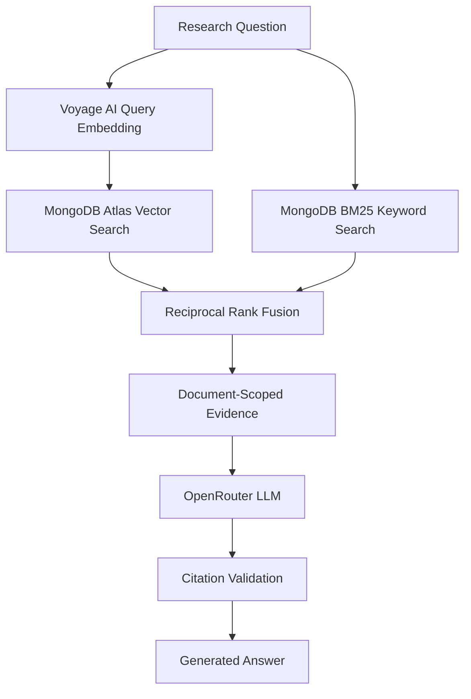

# ResearchAI — MongoDB Atlas Integration Verification

**Verification Date:** November 11, 2026  
**Verification Status:** Passed  
**Scope:** MongoDB Atlas connectivity, Hybrid RAG retrieval, and OpenRouter integration

## 1. Overview

This report documents the successful integration verification of ResearchAI with **MongoDB Atlas, Voyage AI, Hybrid Retrieval-Augmented Generation (RAG), and OpenRouter**.

The objective was to verify that the configured services could communicate successfully and execute a document-scoped retrieval and answer-generation workflow using real external integrations.

The verification used synthetic research content and an isolated test database to avoid modifying application data.

## 2. Verified Components

| Component | Technology | Verification |
|---|---|---|
| Database Connectivity | MongoDB Atlas | Authentication and database access succeeded |
| Semantic Embeddings | Voyage AI | Real query and document embeddings generated |
| Vector Retrieval | Atlas Vector Search | Search queries completed successfully |
| Keyword Retrieval | MongoDB Search BM25 | Keyword queries completed successfully |
| Rank Fusion | Python RRF | Semantic and keyword rankings combined |
| Answer Generation | OpenRouter | LLM generated a cited answer |
| Document Isolation | Document-scoped filtering | Returned sources belonged to the selected document |
| API Gateway | FastAPI | Health and API route checks passed |
| Search Indexes | MongoDB Atlas | Both configured indexes were compatible and queryable |

The integration check confirmed that the retrieval pipeline could execute using the configured external services rather than simulated search results.

## 3. Integration Architecture



The retrieval pipeline combines semantic similarity and keyword relevance through Reciprocal Rank Fusion.

Document filters ensure that retrieved evidence belongs to the selected research paper.

## 4. Verification Results

### Automated Tests

| Test | Result |
|---|---|
| Backend regression tests | 303 passed |
| Optional live checks excluded from regression suite | 4 |
| Separately executed Atlas integration test | 1 passed |
| Scoped Ruff lint and formatting | Passed |
| Database-name regression test | Passed |

The live Atlas test was executed separately from the standard backend regression suite.

### API Gateway Verification

The FastAPI gateway was restarted using the configured Atlas environment.

The following checks succeeded:

- Gateway health endpoint returned HTTP `200`.
- Chat and summary endpoints appeared in the OpenAPI specification.
- A database-backed lookup for an unknown document returned HTTP `404`.
- The application successfully connected to MongoDB Atlas.

**Note:** A successful health response confirms gateway liveness, not the readiness of every external AI service.

## 5. MongoDB Atlas Search Verification

ResearchAI uses two search indexes on its searchable chunk collection.

| Index | Default Name | Purpose |
|---|---|---|
| Vector Search | `chunk_embeddings_v1` | Semantic embedding retrieval |
| Keyword Search | `chunk_keywords_v1` | BM25 keyword retrieval |

Both indexes were confirmed compatible and queryable during the verification.

The live test exercised document-scoped retrieval using real Voyage embeddings and both Atlas search strategies.

### Index Management

To inspect the configured indexes, run:

```bash
python -m backend.services.rag_service.indexes
```

To create missing indexes:

```bash
python -m backend.services.rag_service.indexes --create
```

Index creation is asynchronous. The application requires compatible, queryable indexes before executing the complete Hybrid RAG workflow.

Existing incompatible index definitions are not automatically replaced.

## 6. Live Integration Test

The following test verifies the external retrieval and answer-generation integration:

```bash
RESEARCHAI_RUN_RAG_LIVE=1 \
python -m pytest \
backend/tests/test_rag_live.py::test_live_atlas_hybrid_chat_document_isolation -q
```

The test requires `RESEARCHAI_TEST_ATLAS_URI` to be configured for an isolated test database.

It exercises:

1. Generation of real Voyage AI embeddings.
2. Storage of synthetic research chunks in MongoDB Atlas.
3. Semantic retrieval using Atlas Vector Search.
4. Keyword retrieval using MongoDB Search BM25.
5. Rank fusion using RRF.
6. Answer generation through OpenRouter.
7. Citation validation and document isolation.

The generated answer contained the expected information from the synthetic test input and a verified source citation.

The test created and removed its own disposable database without deleting existing application data.

External provider calls may consume API credits.

## 7. Integration Issue and Resolution

During initial verification, the generated test database name exceeded the configured cluster's 38-byte database-name limit.

The test namespace was updated to use a shorter, uniquely generated `researchai_test` database name.

After the correction, the live Atlas integration test completed successfully.

The change was limited to test database naming and did not modify production database names or application data.

## 8. Verification Scope and Limitations

The verification used synthetic parsed artifacts and synthetic PDF content.

The following boundaries apply:

- LlamaParse extraction was not included in this specific Atlas integration test.
- No private research documents or user conversations were used.
- The test did not migrate existing local MongoDB data into Atlas.
- Existing application search indexes were preserved.
- The test verified integration functionality, not scientific answer correctness.
- No Ragas accuracy scores were produced by this test.
- The results do not establish that Hybrid RAG is generally superior to semantic-only retrieval.

New documents must complete the required extraction, chunking, and embedding stages before retrieval is available.

## 9. Related Documentation

- [MongoDB Atlas Setup](atlas-setup.md)
- [Hybrid RAG Architecture](hybrid-rag.md)
- [System Architecture](architecture.md)
- [RAG Evaluation](rag-evaluation.md)
- [Final QA Report](final-qa.md)

---

## Conclusion

The November 11, 2026 verification confirmed successful integration between **Voyage AI, MongoDB Atlas Vector Search, BM25 keyword retrieval, Python Reciprocal Rank Fusion, and OpenRouter**.

Both application search indexes were verified, document-scoped retrieval succeeded, and a source-grounded response was generated using real external services.

**Overall result:** Atlas integration verified successfully under the documented test conditions. Broader retrieval quality, scientific accuracy, and production readiness require separate evaluation.
