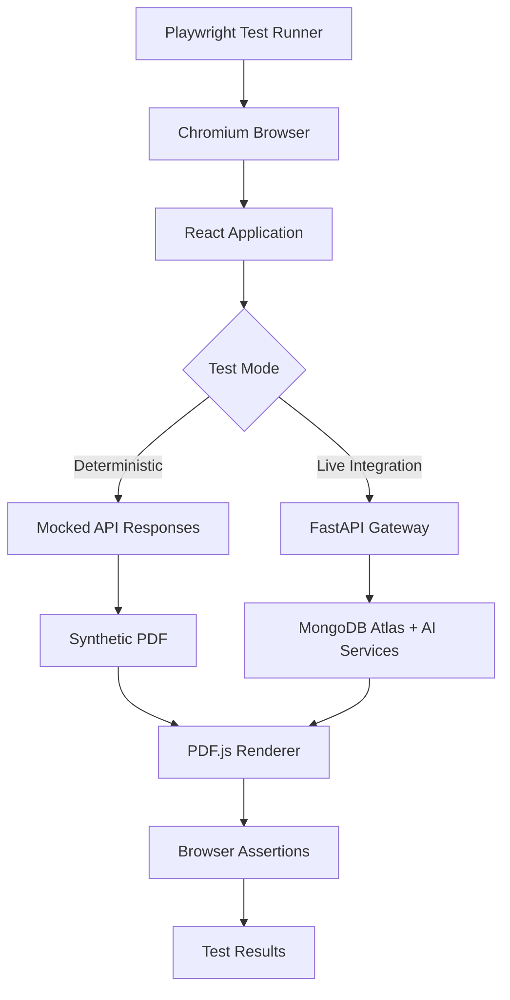

# ResearchAI — Browser Testing and Quality Assurance

ResearchAI uses **Playwright, Vitest, and TypeScript** to verify frontend functionality, user interactions, PDF rendering, and responsive layouts.

The browser testing framework validates the actual React application using Chromium and the existing PDF.js renderer.

It combines deterministic browser tests with optional live integration checks to evaluate both interface behavior and real backend connectivity.

## 1. Testing Overview

The frontend quality assurance strategy includes three testing levels:

| Testing Level | Technology | Purpose |
|---|---|---|
| Unit Testing | Vitest | Verify frontend components and application logic |
| Browser Testing | Playwright | Validate complete user interactions in Chromium |
| Live Integration Testing | Playwright, FastAPI, MongoDB Atlas | Verify browser-to-backend integration |

The default browser suite uses simulated API responses and synthetic PDF data. It does not require MongoDB, external AI providers, or API credits.

Live integration testing is executed separately and requires a configured application environment.

## 2. Browser Testing Architecture



The deterministic suite launches an isolated Vite server and intercepts application API requests.

Each test runs in an isolated browser context to prevent state leakage between scenarios.

## 3. Automated Test Coverage

The Playwright suite verifies the application's core user workflows.

### Document Upload

- PDF file selection and drag-and-drop
- Upload dialog interactions
- Keyboard dismissal and focus restoration
- Upload retry behavior
- Clearing previous file selections
- Validation and processing feedback

### Document Processing

- Queued and active processing states
- Successful document completion
- Failed processing states
- Retry interactions
- Prevention of premature document readiness

### Research Workspace

- Dashboard navigation
- Structured summary presentation
- Chatbot conversations
- Preservation of chat messages and drafts
- Switching between research sections
- Document menu and deletion cancellation

### PDF Citation Viewer

- Original PDF rendering through PDF.js
- Source-page navigation
- Exact text highlighting
- Page-only fallback when matching is unavailable
- Page and zoom preservation
- Repeated citation navigation
- Invalid or foreign citation handling
- PDF viewer visibility and state persistence

### Browser Error Detection

The tests also monitor unexpected JavaScript page errors and verify that unsupported source references are handled safely.

## 4. Responsive Design Verification

ResearchAI tests its interface across six viewport widths.

| Viewport Width | Testing Focus |
|---|---|
| 375px | Mobile layout |
| 768px | Tablet layout |
| 1024px | Small desktop |
| 1280px | Desktop navigation |
| 1440px | Standard desktop |
| 1920px | Large desktop |

Responsive checks cover the dashboard, upload interface, summary workspace, chatbot, and PDF viewer.

The tests verify:

- No root-level horizontal overflow
- Responsive navigation
- Readable summary content
- Desktop PDF split-view layout
- Mobile PDF presentation
- Dialog focus management
- Preserved document and conversation state

The desktop PDF workspace supports an approximately **55:45 split layout**, while mobile devices use a dedicated PDF viewing interface.

Viewport emulation does not replace testing on physical devices.

## 5. Running Automated Tests

Run the following commands from the repository root.

### Install Dependencies

```bash
cd frontend
npm ci --no-audit --no-fund
npx playwright install chromium
```

### Run Frontend Tests

```bash
npm test
```

### Run TypeScript Validation

```bash
npm run typecheck
```

### Run Playwright Browser Tests

```bash
npm run test:e2e
```

### Verify Production Build

```bash
npm run build
```

The default Playwright configuration starts a local Vite test server on port `4173`.

The deterministic browser suite uses an in-memory seven-page PDF and intercepted API responses.

No provider credentials or paid API requests are required.

## 6. Live Integration Testing

ResearchAI includes an optional live browser test that verifies communication with the actual backend and configured external services.

This test is excluded from standard CI execution because it may consume API credits.

### Prerequisites

Before running the live test, ensure that:

- The FastAPI gateway is running.
- Background workers are available.
- MongoDB Atlas is configured.
- Required AI provider credentials are valid.
- The benchmark research paper has been processed.
- A completed summary is available.

The test uses the publicly available research paper:

**[Lost in the Middle: How Language Models Use Long Contexts](https://aclanthology.org/2024.tacl-1.9/)**

The source PDF is validated using its SHA-256 identity before execution.

### Run the Live Test

From the `frontend` directory:

```bash
RESEARCHAI_LIVE_QA=1 \
RESEARCHAI_QA_PDF=/absolute/path/to/the/reviewed-paper.pdf \
RESEARCHAI_QA_DOCUMENT_ID=YOUR_24_CHARACTER_DOCUMENT_ID \
npm run test:e2e -- --workers=1
```

Replace the example paths and document identifier with the actual benchmark values.

### Live Verification Coverage

The live test verifies:

1. PDF upload through the actual FastAPI endpoint.
2. Duplicate document detection.
3. Retrieval of the saved structured summary.
4. Research chatbot response generation.
5. Document-scoped citation validation.
6. Navigation to the original PDF.
7. Source highlighting.
8. Mobile PDF interactions.
9. Preservation of chat and viewer state.

The live test uses the configured application services instead of simulated provider responses.

Completed document-processing artifacts are reused, avoiding unnecessary repeated parsing and embedding generation.

## 7. Browser Configuration

Playwright uses Chromium by default.

To run tests using an installed Google Chrome browser with an isolated test profile:

```bash
PLAYWRIGHT_CHROMIUM_CHANNEL=chrome npm run test:e2e
```

The default downloaded Chromium browser can be selected with:

```bash
PLAYWRIGHT_CHROMIUM_CHANNEL=chromium npm run test:e2e
```

Tests do not access personal browser profiles.

### Screenshots and Test Artifacts

Optional screenshots can be saved by configuring:

`RESEARCHAI_QA_SCREENSHOTS`

The value must point to an existing absolute directory.

Generated browser artifacts are stored under:

```text
frontend/test-results/
frontend/playwright-report/
```

These directories are excluded from Git and Docker build contexts.

Browser traces and screenshots may contain research content or conversation text and should not be published without review.

## 8. Verified Test Results

The documented browser QA verification was completed on **November 13, 2026**.

| Verification | Result |
|---|---|
| Deterministic Playwright tests | 14 passed |
| Browser | Chromium 158 |
| Optional live browser test | 1 passed |
| Responsive viewport checks | 6 widths verified |
| TypeScript checks | Passed |
| Production frontend build | Passed |
| Docker smoke test | Passed |

The live browser verification successfully exercised the configured gateway, MongoDB Atlas, and AI integrations.

Responsive screenshots and PDF source highlighting were also visually inspected.

The Docker smoke test covered the Nginx proxy, PDF upload, duplicate detection, GridFS persistence, document status, and deletion.

These results apply to the tested application version and environment.

## 9. CI Integration

The project's GitHub Actions workflow includes automated frontend verification.

The CI process runs:

1. Dependency installation
2. Frontend unit tests
3. TypeScript validation
4. Production build
5. Deterministic Playwright browser tests
6. Docker integration smoke checks

Live provider tests are excluded from normal CI execution.

This keeps automated verification reproducible without requiring external API credentials or paid model calls.

See [CI Documentation](ci.md).

## 10. Engineering Decisions

| Decision | Rationale |
|---|---|
| Playwright | Test actual browser interactions |
| Chromium | Provide reproducible browser execution |
| API Interception | Test frontend behavior without external dependencies |
| Synthetic PDF Fixtures | Validate PDF rendering without private research documents |
| Isolated Browser Contexts | Prevent test-state contamination |
| Semantic Selectors | Improve test reliability and maintainability |
| Responsive Viewport Matrix | Detect layout and navigation issues |
| Separate Live Tests | Verify real integrations without increasing routine CI costs |
| Private Test Artifacts | Reduce accidental exposure of research content |

The tests reuse the existing React application and PDF.js implementation rather than introducing a separate testing interface.

## 11. Limitations

The current browser verification has several limitations:

- Safari and Firefox were not tested.
- Physical mobile devices were not included.
- Dedicated screen-reader testing was not performed.
- Browser viewport emulation does not establish full accessibility compliance.
- Synthetic API responses do not measure external provider reliability.
- Browser tests do not establish scientific accuracy of AI-generated answers.
- Live tests depend on external services, credentials, and available API credits.

Additional cross-browser, accessibility, and production-load testing is recommended before public deployment.

## 12. Related Documentation

- [System Architecture](architecture.md)
- [API Gateway](../backend/gateway/README.md)
- [PDF Citations](pdf-citations.md)
- [Hybrid RAG](hybrid-rag.md)
- [CI Verification](ci.md)
- [Final QA Report](final-qa.md)
- [Demo Guide](demo-guide.md)

### References

- [Playwright Best Practices](https://playwright.dev/docs/best-practices)
- [Playwright Web Server Configuration](https://playwright.dev/docs/test-webserver)
- [Playwright Browser Contexts](https://playwright.dev/docs/test-use-options)

---

**ResearchAI Browser QA — Verifying reliable user interactions, responsive interfaces, and source-grounded research workflows.**
