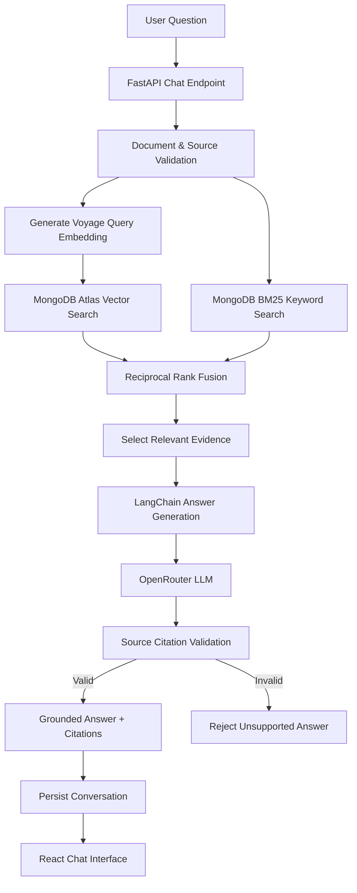

# ResearchAI — Hybrid Retrieval-Augmented Generation

ResearchAI implements a **document-scoped Hybrid Retrieval-Augmented Generation (RAG)** pipeline that combines semantic vector search and BM25 keyword retrieval to generate research answers grounded in uploaded PDF documents.

The system uses **Voyage AI, MongoDB Atlas Vector Search, MongoDB Search, LangChain, Reciprocal Rank Fusion (RRF), and OpenRouter**.

Its primary objective is to retrieve relevant document evidence, generate context-aware responses, and provide verifiable source citations.

## 1. System Architecture



The pipeline uses two retrieval strategies to identify relevant information from the currently selected research paper.

All retrieval operations are restricted to the active document, chunk set, and embedding profile.

## 2. Hybrid Retrieval Architecture

### 2.1 Semantic Vector Search

Semantic retrieval uses **Voyage AI** to transform a user's question into a dense embedding vector.

MongoDB Atlas Vector Search identifies document chunks with similar semantic meaning.

This enables the system to retrieve relevant information even when the question uses different terminology from the source document.

### 2.2 BM25 Keyword Search

BM25 retrieves passages based on lexical relevance.

It is particularly useful for technical terminology, mathematical expressions, model names, author names, and exact phrases.

MongoDB Search performs keyword retrieval using the configured BM25 similarity and `lucene.standard` analyzer.

### 2.3 Reciprocal Rank Fusion

ResearchAI combines the rankings from both retrieval strategies using **Reciprocal Rank Fusion (RRF)**.

The general scoring formula is:

\[
RRF(d)=\sum_{r\in R}\frac{1}{k+\operatorname{rank}_r(d)}
\]

Where:

- \(d\) is a retrieved document chunk.
- \(R\) represents the retrieval ranking lists.
- \(k\) is the configured fusion constant.
- \(\operatorname{rank}_r(d)\) is the position of chunk \(d\) in ranking \(r\).

RRF combines retrieval rankings without directly mixing the raw similarity scores returned by the two search systems.

The retrieval branches execute through LangChain `RunnableParallel`, and a Python fusion implementation deduplicates and ranks the candidates.

**Important:** RRF scores indicate relative ranking, not factual accuracy or model confidence.

## 3. Retrieval Configuration

The following configuration values control the retrieval pipeline.

| Configuration | Default | Purpose |
|---|---|---|
| `VECTOR_SEARCH_INDEX_NAME` | `chunk_embeddings_v1` | Atlas vector index |
| `KEYWORD_SEARCH_INDEX_NAME` | `chunk_keywords_v1` | MongoDB keyword index |
| `RAG_CANDIDATE_K` | `20` | Candidates per retrieval branch |
| `RAG_CONTEXT_K` | `6` | Final context selection limit |
| `RAG_RRF_CONSTANT` | `60` | Reciprocal Rank Fusion constant |
| `RAG_CONTEXT_BYTES` | `32000` | Maximum UTF-8 context budget |
| `RAG_HISTORY_TURNS` | `6` | Conversation history limit |

These values can be adjusted through the application configuration.

## 4. MongoDB Atlas Search Indexes

Hybrid retrieval requires two compatible search indexes on the `chunk_embeddings` collection.

**Vector index:** Stores and searches Voyage AI embeddings using the configured dimensions and cosine similarity.

**Keyword index:** Supports BM25 retrieval over document text.

Both indexes support filtering by document identity, active chunk set, and embedding profile.

### Inspect Index Definitions

Run from the repository root:

```bash
python -m backend.services.rag_service.indexes
```

### Create Missing Indexes

```bash
python -m backend.services.rag_service.indexes --create
```

Index creation is asynchronous. Both indexes must become queryable before hybrid retrieval can run successfully.

The index management command does not automatically delete or overwrite incompatible existing indexes.

**Database requirement:** A standard local MongoDB deployment can support storage and persistence testing but does not provide the Atlas Search capabilities required by the complete Hybrid RAG pipeline.

Refer to the [MongoDB Atlas Setup Guide](atlas-setup.md).

## 5. Grounded Answer Generation

After retrieving relevant document chunks, ResearchAI constructs a bounded evidence context and sends it to the configured language model through OpenRouter.

LangChain coordinates the answer-generation workflow.

### Answer Generation Steps

1. Validate the selected document and its active processing version.
2. Execute semantic and keyword retrieval.
3. Combine the results using RRF.
4. Select the relevant evidence within the configured context budget.
5. Generate a structured response using the OpenRouter model.
6. Validate generated claims and source references.
7. Return the answer with verified citations or reject unsupported output.

### Source Validation

Generated paper-specific claims require references to actual retrieved document evidence.

The system checks citation identity, page references, and supporting quotations against current document chunks.

If retrieval returns no relevant evidence, the system abstains without making an unnecessary LLM request.

If the model produces unsupported claims or invalid citations, the response is rejected rather than saved as a successful answer.

**Limitation:** Exact quotation validation confirms that cited text exists in the source. It does not independently prove that every generated claim is scientifically correct.

## 6. Context and Conversation Handling

ResearchAI supports document-scoped conversations with saved question-and-answer history.

Conversation history helps interpret follow-up questions but is not treated as independent factual evidence.

### Context Management

The system applies configurable limits to:

- Retrieved source passages
- Conversation history
- Prompt size
- Final evidence selection

When context exceeds the configured limit, older conversation history is removed before excluding complete source chunks.

Source content is not silently truncated in the middle of a chunk.

### Conversation Persistence

Successful turns are stored in MongoDB with:

- User question
- Generated answer
- Verified citations
- Conversation and sequence identifiers
- Internal evaluation trace

Conversation records are associated with the document and its active source generation.

Concurrent requests within a single conversation are controlled to prevent inconsistent conversation history.

## 7. API Endpoints

The FastAPI gateway provides document-grounded chatbot endpoints.

| Method | Endpoint | Purpose |
|---|---|---|
| `POST` | `/api/v1/documents/{id}/chat` | Submit a research question |
| `GET` | `/api/v1/documents/{id}/chat/{conversation_id}` | Retrieve saved conversation history |

### Example Chat Request

```bash
curl -X POST \
  http://localhost:8000/api/v1/documents/DOCUMENT_ID/chat \
  -H "Content-Type: application/json" \
  -d '{"message":"What method does this paper use?"}'
```

Replace `DOCUMENT_ID` with an existing processed document identifier.

The response includes the generated answer, source citations, and a conversation identifier.

The conversation identifier can be reused for subsequent questions.

### Error Handling

| HTTP Status | Meaning |
|---|---|
| `404` | Document or conversation not found |
| `409` | Document not ready, conversation busy, or source version changed |
| `422` | Invalid request |
| `503` | Required storage, search, or provider service unavailable |

Retrieval failures are reported explicitly. The system does not silently substitute a fake semantic search or BM25-only fallback when Atlas is unavailable.

## 8. Running the RAG Pipeline

A document must be parsed and chunked before embedding generation.

### Generate Embeddings

```bash
python -m backend.services.document_processor.embed_cli DOCUMENT_ID
```

### Initialize Atlas Search Indexes

```bash
python -m backend.services.rag_service.indexes --create
```

Wait until both search indexes are queryable.

### Execute a Research Question

```bash
python -m backend.services.rag_service.main \
  DOCUMENT_ID \
  "What method does this paper use?"
```

Embedding generation and LLM requests may consume provider credits.

## 9. Citation Integration

ResearchAI connects generated answers to the original PDF using validated source references.

Each citation can contain:

- Document identity
- Chunk identity
- Source page number
- Supporting quotation
- Source generation information

The React chatbot displays verified citations and supporting evidence.

Selecting a citation opens the PDF viewer and navigates to the relevant page.

Text or region highlighting is used when sufficiently precise source information is available. Otherwise, the viewer provides page-level navigation.

See [PDF Citation Documentation](pdf-citations.md).

## 10. Offline RAG Evaluation

ResearchAI separates quality evaluation from normal chatbot requests.

The answer pipeline can return an internal evaluation trace containing the question, generated answer, retrieved evidence, source references, and relevant configuration.

These traces are used for offline Ragas evaluation and are excluded from public chatbot responses.

### Evaluation Metrics

| Metric | Purpose |
|---|---|
| Context Precision | Evaluate relevance of retrieved passages |
| Context Recall | Measure evidence coverage |
| Faithfulness | Evaluate whether claims are supported by context |
| Answer Relevancy | Measure response relevance |
| Factual Correctness | Compare responses with reference answers |

The evaluation framework supports comparisons between semantic-only and hybrid retrieval.

Results are interpreted with appropriate sample coverage, source reviews, and recorded metric failures.

See [RAG Evaluation Documentation](rag-evaluation.md).

## 11. Testing and Verification

ResearchAI includes deterministic retrieval tests, MongoDB integration tests, and optional live-provider verification.

### Live OpenRouter Verification

```bash
RESEARCHAI_RUN_ANSWER_LIVE=1 \
python -m pytest \
backend/tests/test_rag_live.py::test_live_openrouter_grounded_answer -q
```

### Live MongoDB Atlas Verification

Configure `RESEARCHAI_TEST_ATLAS_URI` using a permitted disposable test database.

```bash
RESEARCHAI_RUN_RAG_LIVE=1 \
python -m pytest \
backend/tests/test_rag_live.py::test_live_atlas_hybrid_chat_document_isolation -q
```

The Atlas integration test uses synthetic research content, actual Voyage embeddings, MongoDB Atlas retrieval, and OpenRouter answer generation.

The documented live verification completed successfully on November 11, 2026.

It confirmed that the configured vector and BM25 indexes were queryable and that the application could generate a cited answer using retrieved evidence.

**Verification boundary:** This confirms integration functionality, not overall retrieval accuracy or superiority over semantic-only search.

See the [Atlas Verification Report](atlas-verification.md).

## 12. Engineering Decisions

| Decision | Rationale |
|---|---|
| Hybrid retrieval | Combine conceptual matching with exact terminology |
| Reciprocal Rank Fusion | Merge rankings without depending on comparable raw scores |
| Document-scoped filtering | Prevent evidence from unrelated documents |
| Source generation validation | Avoid outdated or incompatible retrieval artifacts |
| Context budgeting | Control prompt size and provider usage |
| Strict citation validation | Reject unsupported source references |
| Atomic conversation persistence | Avoid incomplete saved question-and-answer turns |
| Offline evaluation | Keep quality measurement separate from user-facing latency |

## 13. Limitations and Future Improvements

The current Hybrid RAG implementation has several limitations:

- Retrieval quality depends on embedding-model compatibility and MongoDB Atlas search availability.
- Context limits may exclude evidence required for complex questions.
- Strict citation verification can reject useful responses when a model produces invalid source quotations.
- Quote matching does not establish the correctness of the interpretation.
- Conversation recovery may require manual intervention after an interrupted request.
- Authentication, per-user authorization, and production-grade data retention controls remain future requirements.
- Voyage reranking is configurable but is not part of the current RRF retrieval pipeline.

Future improvements include retrieval reranking, broader benchmark coverage, better evidence selection, and more robust answer attribution.

## 14. References

- [MongoDB Atlas Vector Search](https://www.mongodb.com/docs/vector-search/)
- [MongoDB Search and BM25](https://www.mongodb.com/docs/search/indexes/field-types/string-type/)
- [LangChain Documentation](https://docs.langchain.com/)
- [Voyage AI Documentation](https://docs.voyageai.com/)
- [Ragas Evaluation](https://docs.ragas.io/)
- [ResearchAI System Architecture](architecture.md)

---

**ResearchAI Hybrid RAG — Combining semantic and keyword retrieval with source-grounded answer generation.**
