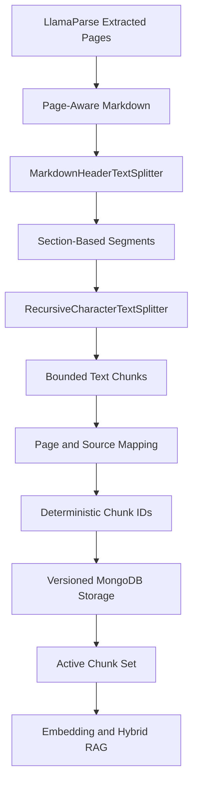

# ResearchAI — Markdown-Aware Document Chunking

ResearchAI implements a **Markdown-aware, page-preserving text chunking pipeline** using LangChain to transform extracted academic PDF content into structured, searchable text segments.

The chunking system preserves document hierarchy, page references, and source metadata, enabling accurate document retrieval and verifiable citations in the Hybrid RAG pipeline.

## 1. Overview

Traditional fixed-size text splitting can divide research content without respecting section boundaries or document structure.

ResearchAI addresses this by combining **MarkdownHeaderTextSplitter** and **RecursiveCharacterTextSplitter** to create bounded chunks while retaining the original research paper's structure.

### Key Capabilities

- **Structure-Aware Splitting:** Preserves Markdown heading hierarchy and section boundaries.
- **Configurable Chunking:** Supports adjustable chunk size and overlap.
- **Page-Aware Attribution:** Tracks which PDF pages contributed to each chunk.
- **Source Metadata:** Retains available source elements and coordinate information.
- **Deterministic Chunk IDs:** Generates stable identifiers for matching inputs and configurations.
- **Versioned Persistence:** Publishes only complete chunk sets in MongoDB.
- **Recovery Support:** Reuses completed chunks and avoids publishing partial results.

Chunking operates on previously extracted document content and does not require additional AI provider calls.

---

## 2. Chunking Architecture



The pipeline executes after PDF parsing and before embedding generation.

Each stage preserves the metadata required to connect generated responses to the original source document.

## 3. Chunking Strategy

### 3.1 Markdown Header Splitting

ResearchAI uses LangChain's `MarkdownHeaderTextSplitter` to identify document headings and maintain their hierarchy.

The implementation recognizes Markdown headings from `#` through `######`.

For example:

```markdown
# Introduction

Research background and motivation.

## Methodology

Details of the proposed approach.

### Model Architecture

Explanation of model components.
```

Sections with different heading contexts remain separate.

Headings inside fenced code blocks are not interpreted as research section boundaries.

### 3.2 Recursive Character Splitting

After grouping content by heading, ResearchAI uses `RecursiveCharacterTextSplitter` to enforce chunk-size limits.

The splitter prioritizes natural text boundaries such as paragraphs, lines, and words before splitting at individual characters.

This helps preserve context while maintaining manageable chunk sizes.

### 3.3 Chunk Overlap

Overlap retains a configurable amount of preceding content between adjacent chunks within the same section.

The default configuration uses:

- **Chunk Size:** 1,200 characters
- **Chunk Overlap:** 150 characters

Actual overlap may be smaller depending on text boundaries and section structure.

The configuration is measured in Python characters, not tokens or UTF-8 bytes.

## 4. Configuration

The chunking pipeline supports the following environment variables.

| Setting | Default | Description |
|---|---|---|
| `CHUNK_SIZE` | `1200` | Maximum characters per chunk |
| `CHUNK_OVERLAP` | `150` | Target character overlap between adjacent chunks |

The configuration must satisfy:

```text
CHUNK_SIZE > 0
0 <= CHUNK_OVERLAP < CHUNK_SIZE
```

Invalid configurations are rejected before chunking begins.

Command-line arguments can override the environment settings for individual executions.

## 5. Page-Aware Source Attribution

ResearchAI preserves the original PDF page references during chunking.

Page markers are introduced internally from the parsed page numbers and removed before chunk content is persisted.

A chunk may contain content spanning multiple pages when the same document section continues across page boundaries.

### Chunk Metadata

Each stored chunk retains relevant information such as:

| Metadata | Purpose |
|---|---|
| `document_id` | Source document identifier |
| `parse_run_id` | Source extraction version |
| `chunk_set_id` | Chunk generation identifier |
| `chunk_index` | Ordered position within the chunk set |
| `heading_path` | Document heading hierarchy |
| `section_title` | Current research section |
| `page_numbers` | Contributing PDF pages |
| `page_spans` | Page-specific evidence and chunk offsets |
| `source_element_ids` | Matched extracted source elements |
| `bounding_boxes` | Available source-region coordinates |

Page spans identify the portion of chunk text associated with each source page.

These offsets refer to normalized chunk content, not exact character positions in the original PDF.

### Source Mapping Rules

ResearchAI applies conservative source attribution:

- Blank pages are not treated as supporting evidence.
- Source elements are associated only when supporting text can be matched unambiguously.
- Repeated or ambiguous text uses page-level attribution.
- Unknown coordinate systems do not produce invented source boxes.
- Original extracted Markdown and PDF content remain authoritative.

This metadata supports downstream citation verification and PDF source navigation.

## 6. Deterministic Chunk Generation

ResearchAI generates stable chunk identifiers based on document content, extraction provenance, configuration, and splitter version.

### Benefits

- Identical inputs produce consistent chunk identities.
- Repeated processing can reuse existing records.
- Configuration changes create separate chunk generations.
- Previously published chunks remain available during reprocessing.
- Downstream systems can verify which source generation produced their evidence.

Chunking algorithm changes are represented through an explicit algorithm version.

This prevents incompatible chunk-generation behavior from silently reusing previously stored results.

## 7. MongoDB Persistence

Chunk results are stored in MongoDB using immutable, versioned chunk sets.

The persistence workflow separates chunk creation from publication.

### Processing Workflow

1. Load the active completed PDF extraction.
2. Validate document and parsing provenance.
3. Claim the document for chunk processing.
4. Generate the new deterministic chunk set.
5. Persist chunk records using stable identifiers.
6. Verify completeness and source consistency.
7. Publish the new `active_chunk_set_id`.

Only the active, complete chunk generation is returned to downstream consumers.

### Data Consistency

The chunk reader validates:

- Active chunk-set identity
- Expected chunk count
- Chunk ordering
- Matching extraction generation
- Document isolation

Partial or incompatible results are not exposed as completed chunk sets.

### Recovery

If processing fails before publication, the existing active chunk set remains unchanged.

A supported retry can reuse previously written records belonging to the same deterministic generation.

Abandoned partial records may require manual reconciliation.

The system does not automatically remove older chunk generations.

## 8. Core Functions

The chunking implementation exposes reusable processing functions.

### `chunk_document()`

```python
chunk_document(parsed, parse_run_id, config)
```

Transforms a normalized parsed document into deterministic, page-aware text chunks.

This function handles document structure, chunk boundaries, source metadata, and chunk identification.

### `chunk_stored_document()`

```python
chunk_stored_document(database, document_id, settings)
```

Coordinates chunk generation and persistence for a previously parsed document.

It manages processing claims, MongoDB writes, source-generation checks, and active chunk-set publication.

### `read_document_chunks()`

Retrieves the complete active chunk set for a document.

The reader verifies chunk-set completeness and consistency before returning results.

These functions separate text transformation from database orchestration and retrieval.

## 9. Running the Chunking Pipeline

Execute the following commands from the repository root with backend dependencies installed.

A document must already have a completed parsing result.

### Default Configuration

```bash
python -m backend.services.document_processor.chunk_cli DOCUMENT_ID
```

### Custom Configuration

```bash
python -m backend.services.document_processor.chunk_cli \
  DOCUMENT_ID \
  --chunk-size 1200 \
  --chunk-overlap 150
```

Replace `DOCUMENT_ID` with the identifier returned during PDF upload.

### Retrieve Generated Chunks

```bash
curl http://localhost:8000/api/v1/documents/DOCUMENT_ID/chunks
```

The API returns the complete active chunk set.

The read endpoint does not initiate new parsing, chunking, or embedding operations.

## 10. Chunk Retrieval API

**Endpoint:**

`GET /api/v1/documents/{id}/chunks`

### Response Behavior

The endpoint returns stored document chunks with their associated page and source metadata.

Only a complete chunk set matching the active parsing generation can be returned.

### Error Handling

| HTTP Status | Meaning |
|---|---|
| `404` | Document not found |
| `409` | Chunking incomplete or source generation mismatch |
| `422` | Invalid document identifier |
| `503` | Storage service unavailable |

The endpoint currently returns the complete chunk set without pagination.

## 11. Index Compatibility

ResearchAI uses a unique MongoDB index across:

```text
(document_id, chunk_set_id, chunk_index)
```

This supports multiple immutable chunk generations for the same document.

Older schemas using only `(document_id, chunk_index)` can conflict with versioned storage.

The application handles empty legacy collections automatically where supported.

For populated legacy collections, index changes require manual review and a controlled migration.

Existing records should not be deleted or indexes dropped without verifying compatibility with active services.

## 12. Testing and Verification

The chunking pipeline includes tests for:

- Markdown heading hierarchy
- Recursive splitting and overlap
- Section boundaries
- Cross-page chunk continuation
- Source element matching
- Page and coordinate metadata
- Deterministic identifiers
- Invalid configuration
- MongoDB persistence
- Reprocessing and artifact reuse
- Partial write recovery
- Document isolation
- Legacy index compatibility

### Backend Tests

```bash
python -m pytest backend/tests -q
```

### MongoDB Integration Tests

Use an isolated local MongoDB instance:

```bash
RESEARCHAI_TEST_MONGODB_URI=mongodb://localhost:27017 \
python -m pytest backend/tests -q
```

Tests create disposable databases and remove their own resources.

### CLI Verification

```bash
python -m backend.services.document_processor.chunk_cli --help
```

### Verified Results

The documented November 11, 2026 verification produced:

| Test Environment | Result |
|---|---|
| Backend with disposable MongoDB | 178 passed, 1 skipped |
| Offline backend tests | 160 passed, 19 skipped |
| Frontend regression tests | 22 passed |
| Frontend production build | Passed |

The tests used actual LangChain text splitters and synthetic parsed documents.

No paid parsing, embedding, or LLM requests were required for chunking verification.

**Verification scope:** These tests validate chunking behavior and persistence. They do not establish PDF extraction accuracy, retrieval effectiveness, or RAG answer correctness.

## 13. Engineering Decisions

| Decision | Rationale |
|---|---|
| Markdown-aware splitting | Preserve research paper structure |
| Recursive character splitting | Enforce bounded chunk sizes |
| Configurable overlap | Retain context across neighboring chunks |
| Page-aware metadata | Enable source-based retrieval and citations |
| Conservative source matching | Avoid fabricated source coordinates |
| Deterministic chunk IDs | Support repeatable processing |
| Versioned chunk sets | Prevent incomplete generations from becoming active |
| Artifact reuse | Reduce unnecessary processing |
| MongoDB persistence | Integrate chunk storage with the document pipeline |

## 14. Limitations and Future Improvements

The current chunking approach has several limitations:

- Character-based limits do not directly represent embedding-model token limits.
- Large tables may require splitting across multiple chunks.
- Source text normalization can alter original Markdown whitespace.
- Some document layouts may produce ambiguous source attribution.
- PDF coordinate information may be incomplete or incompatible.
- Reprocessing interrupted jobs can require manual recovery.
- Complete chunk retrieval currently lacks pagination.

Future improvements may include token-aware chunking, improved table preservation, more advanced layout-based segmentation, and broader chunking-quality evaluation.

## 15. References

- [LangChain Markdown Header Splitter](https://reference.langchain.com/python/langchain-text-splitters/markdown/MarkdownHeaderTextSplitter)
- [LangChain Recursive Character Splitter](https://reference.langchain.com/python/langchain-text-splitters/character/RecursiveCharacterTextSplitter)
- [System Architecture](architecture.md)
- [Document Processing](../backend/services/document_processor/README.md)
- [Hybrid RAG](hybrid-rag.md)
- [PDF Citations](pdf-citations.md)
- [RAG Evaluation](rag-evaluation.md)

---

**ResearchAI Markdown Chunking — Structure-preserving text segmentation for reliable retrieval and source-grounded research.**
