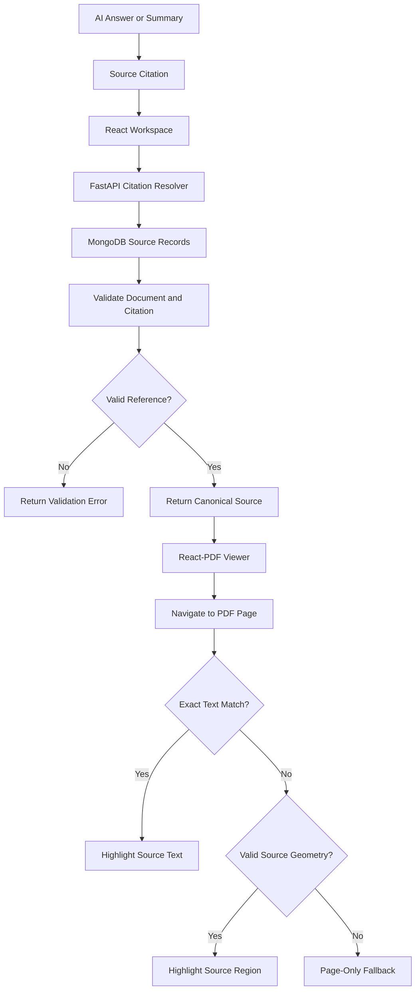
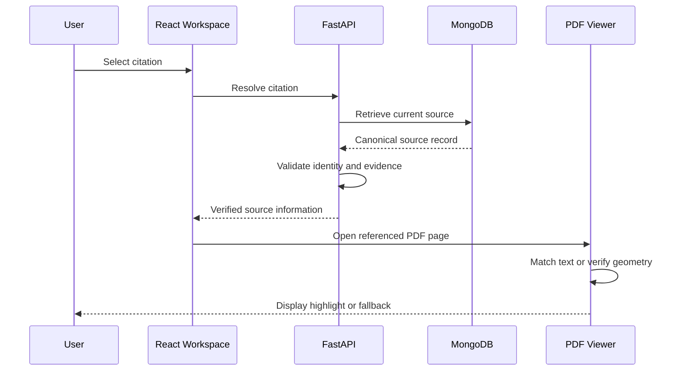

# ResearchAI — PDF Citations and Source Verification

ResearchAI provides an interactive PDF citation system that connects AI-generated answers and structured summaries to supporting evidence in the original research document.

Built with **React-PDF, PDF.js, FastAPI, and MongoDB GridFS**, the citation system enables users to navigate to referenced pages, inspect source quotations, and verify document evidence.

The system prioritizes accurate source navigation and avoids displaying misleading highlights when exact text or source geometry cannot be verified.

## 1. Overview

The PDF citation system supports:

- **Source-grounded citations:** References to the selected document, source chunk, page, and supporting quotation.
- **Interactive PDF navigation:** Open the original PDF directly from chatbot answers or structured summaries.
- **Text highlighting:** Highlight matching source text across lines when exact evidence can be identified.
- **Region highlighting:** Use validated source coordinates when precise text matching is unavailable.
- **Safe fallback:** Navigate to the correct page without inventing a highlight.
- **Responsive viewing:** Support desktop split-screen reading and mobile PDF navigation.

The PDF viewer is optional and opens when the user selects a citation or chooses to view the original document.

---

## 2. System Architecture



Citation resolution is performed on the backend before source navigation. The frontend does not independently trust source coordinates supplied by a model or client.

## 3. Citation Data Model

ResearchAI retains citation metadata identifying the original supporting evidence.

| Field | Purpose |
|---|---|
| Citation ID | Deterministic identifier for the source reference |
| Document ID | Identifies the original research paper |
| Chunk ID | Identifies the supporting text chunk |
| Page Number | Original PDF page reference |
| Source Quote | Supporting text extracted from the document |
| Parse Generation | Identifies the extraction version |
| Chunk Generation | Identifies the active chunk set |
| Source Element ID | Identifies the original extracted source element |
| Bounding Box | Source-region coordinates when available |
| Page Dimensions | Used to validate coordinate compatibility |

Citation IDs represent source identities and are not authentication or authorization tokens.

Version metadata helps prevent citations from pointing to outdated or incompatible document content.

## 4. Backend Citation Resolution

The FastAPI gateway exposes a citation-resolution endpoint.

### Endpoint

`POST /api/v1/documents/{id}/citations/resolve`

The endpoint receives citation information, including the selected document, chunk, page, supporting quotation, and available source-generation identifiers.

### Validation Workflow

1. Retrieve the current document and active source generation.
2. Verify the supplied citation identity.
3. Confirm that the referenced chunk belongs to the selected document.
4. Validate the page and supporting quotation against canonical source records.
5. Check that the citation refers to the current extraction and chunk generation.
6. Return verified source information for PDF navigation.

Client-provided geometry is not accepted as authoritative evidence.

The resolver retrieves source information from stored document records and does not invoke an LLM or paid PDF parsing service.

### Error Handling

| HTTP Status | Meaning |
|---|---|
| `404` | Referenced document does not exist |
| `409` | Document is not ready or source generation has changed |
| `422` | Citation identity, page, chunk, or quotation is invalid |

Invalid or stale references are rejected rather than displayed as verified evidence.

---

## 5. PDF Viewer Architecture

The PDF viewer is implemented using **React-PDF and PDF.js**.

The main viewer component is located at:

`frontend/src/components/pdf/PdfViewerPanel.tsx`

Original PDF content is retrieved from MongoDB GridFS through the backend.

The viewer obtains the actual page count from the loaded PDF and supports:

- Page navigation
- Previous and next page controls
- Zoom between 50% and 200%
- Zoom reset
- PDF loading and retry states
- Source highlighting
- Opening the original PDF

PDF.js workers, character maps, and standard fonts are prepared locally from the installed library version.

The application does not require an external CDN for these assets.

## 6. Source Highlighting Strategy

ResearchAI applies a prioritized highlighting strategy to avoid misleading source visualization.

### 6.1 Exact Text Highlighting

After citation validation, the PDF viewer navigates to the referenced page and searches for the supporting quotation.

The text-matching process accounts for:

- Whitespace differences
- Line breaks
- Soft hyphens
- Compatible text ligatures
- Text spanning multiple rendered elements

When a unique match is found, native DOM Range rectangles are used to highlight the corresponding text.

This preserves the original selectable PDF text layer.

### 6.2 Source Region Highlighting

When exact text matching is unavailable, the viewer may use source-region coordinates obtained during document extraction.

A region highlight is displayed only when the stored geometry can be safely interpreted.

Validation includes:

- Known coordinate units
- Compatible coordinate origin
- Valid page dimensions
- Supported source-element rotation
- Coordinates within page boundaries
- Unambiguous source-element association

LlamaParse source metadata is preserved according to the provider's documented coordinate conventions.

Unknown or incompatible coordinates are not guessed or converted using unsupported assumptions.

### 6.3 Page-Only Fallback

If neither exact text matching nor verified region geometry is available, ResearchAI navigates to the referenced page without an overlay.

The cited page remains available without a technical highlight warning.

This can occur with scanned documents, OCR differences, ambiguous text, or incomplete source coordinates.

**Important:** A source-region highlight identifies a supporting document area. It should not be interpreted as proof that every word in a generated claim has been verified.

---

## 7. Citation Navigation Workflow

Chatbot responses can contain inline citation references such as `[1]`, together with source-page controls.

Selecting a citation initiates the following workflow:



The citation system also protects against stale interactions.

When users switch documents, previous citation selections and pending responses are invalidated.

Unknown numeric references remain ordinary text instead of becoming unsupported links.

Generated content is rendered safely rather than inserted as arbitrary HTML.

## 8. Workspace Integration

Citation navigation is integrated into the ResearchAI document workspace. The viewer is hidden by default; View Original PDF and source citations open the same viewer, and Close PDF restores the wider workspace without clearing chat or summary state.

### Desktop and Tablet

The workspace supports a split layout containing the research summary or chatbot alongside the original PDF.

Users can open and close the PDF without discarding their current research conversation.

### Mobile

Selecting a citation opens the PDF in a dedicated mobile viewing panel.

Returning to the chatbot preserves the existing conversation.

### Viewer State

The workspace retains the PDF viewer instance during supported summary, chatbot, and PDF interactions.

Page position, zoom level, and loaded document state are preserved when the viewer is temporarily hidden.

Repeated citation selections revalidate the source and navigate to the requested page.

---

## 9. Testing and Verification

ResearchAI includes backend, frontend, and browser-level tests for citation handling.

### Backend Verification

Backend tests cover:

- Citation identity validation
- Incorrect document references
- Invalid page numbers
- Unsupported quotations
- Stale source generations
- Source-coordinate validation
- Missing or ambiguous geometry
- API error handling

The documented citation regression verification completed with **325 backend tests passing and four optional live checks excluded**.

### Frontend Verification

Frontend tests cover:

- PDF viewer controls
- Text matching
- Coordinate transformations
- Source highlighting
- Page navigation
- Citation interactions
- Responsive viewer behavior

The isolated frontend verification completed with **69 passing tests** and a successful production build.

### Browser Verification

The citation system was also verified using a three-page synthetic PDF with actual browser PDF rendering.

The browser test exercised real local MongoDB/GridFS storage and gateway routes, while paid retrieval and LLM dependencies were simulated.

Verified behaviors included:

| Scenario | Verified Result |
|---|---|
| Original PDF rendering | Correct three-page document rendered |
| Multi-line quotation | Highlighted across two rendered lines |
| Zoom adjustment | Highlight rectangles recalculated |
| Page navigation | Previous-page overlays cleared |
| Repeated citation selection | Correct page and highlight restored |
| Missing selectable text | Page-only fallback displayed |
| Mobile navigation | PDF opened with responsive layout |
| Conversation persistence | Existing chatbot turns retained |

The browser verification did not establish OCR accuracy or scientific correctness of generated answers.

See [Browser QA Documentation](browser-qa.md) for additional verification details.

---

## 10. Running Citation Verification Locally

### Prerequisites

Ensure that:

- MongoDB is configured.
- The FastAPI gateway and background worker are running.
- The frontend development server is available.
- A PDF has been uploaded and successfully processed.
- The document has valid source metadata and chatbot responses.

### Start the Application

From the repository root:

```bash
docker compose up -d --build --wait
```

Open:

`http://localhost:3000`

Alternatively, use the native development setup described in the main [README](../README.md).

### Verify Citation Navigation

1. Open a processed research paper.
2. Ask the chatbot a question answered by the document.
3. Select an inline citation or source-page button.
4. Confirm that the original PDF opens at the referenced page.
5. Inspect the highlighted text or source region.
6. Change the zoom level and verify overlay alignment.
7. Navigate to another page and select the citation again.
8. Verify mobile navigation and the page-only fallback where applicable.

For documents with incomplete coordinate metadata or OCR differences, confirm that the viewer does not display a fabricated exact-text highlight.

---

## 11. Engineering Decisions

| Decision | Rationale |
|---|---|
| Backend citation resolution | Validate references against canonical document data |
| Deterministic citation identities | Maintain stable source references |
| Source-generation validation | Prevent outdated citations |
| Text-first highlighting | Prioritize direct matches in rendered PDF text |
| Geometry validation | Avoid inaccurate source-region overlays |
| Page-only fallback | Preserve source navigation without misleading highlights |
| Local PDF.js assets | Reduce external runtime dependencies |
| Persistent viewer instance | Preserve reading and conversation state |
| Document-switch protection | Prevent cross-document citation errors |

These decisions prioritize evidence traceability, accurate source navigation, and a predictable research experience.

---

## 12. Limitations and Future Improvements

The citation system has several limitations:

- Scanned PDFs may not contain selectable text.
- OCR output may differ from the original PDF text layer.
- Ambiguous or repeated text cannot always be uniquely highlighted.
- Rotated or incompatible source geometry may prevent region highlighting.
- Page-level navigation does not guarantee that the exact quotation is visually identifiable.
- Verified source identity does not independently establish scientific claim correctness.
- Production security and authorization controls remain future requirements.

Future improvements include better OCR-to-PDF text alignment, additional document-layout coverage, more comprehensive cross-browser testing, and expanded citation-quality evaluation.

---

## 13. Related Documentation

- [System Architecture](architecture.md)
- [Hybrid RAG Pipeline](hybrid-rag.md)
- [Structured Summarization](structured-summary.md)
- [Background Processing](background-jobs.md)
- [Browser QA](browser-qa.md)
- [Final QA Report](final-qa.md)
- [LlamaParse Coordinate Conventions](https://developers.llamaindex.ai/llamaparse/parse/guides/response-format/)

---

**ResearchAI PDF Citations — Connecting AI-generated research insights to verifiable document evidence.**
