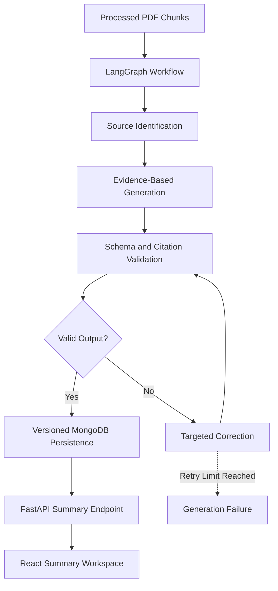

# ResearchAI — Structured Research Summarization

ResearchAI uses **LangGraph, LangChain, OpenRouter, and MongoDB** to generate structured, source-grounded summaries of academic PDF documents.

The summarization system transforms extracted research content into five predefined sections while preserving source references and validating supporting quotations.

Its primary objective is to make complex research papers easier to understand without presenting unsupported information as verified findings.

## 1. Overview

ResearchAI generates research summaries using a consistent five-section format.

| Section | Description |
|---|---|
| Title, Authors & Abstract | Identifies the paper, its authors, and research overview |
| Problem Statement | Explains the problem addressed and its motivation |
| Methodology | Describes the proposed methods, algorithms, and architecture |
| Key Results | Presents experimental findings and reported performance |
| Conclusion | Summarizes contributions, limitations, and future directions |

Missing information is explicitly represented as `null` or an empty author list and displayed as **"Not stated in the document."**

Every populated summary field requires supporting evidence from the processed research paper.

## 2. System Architecture



The workflow operates on previously extracted and chunked document content. It does not require a new PDF parsing operation for every summary request.

Completed summaries can be reused when their source generation and configuration remain compatible.

## 3. LangGraph Summarization Workflow

ResearchAI uses a stateful LangGraph workflow to coordinate summary generation, evidence validation, and persistence.

The primary workflow is:

`identify → generate → validate → advance/combine → save`

### Source Identification

The workflow identifies relevant document sections and supporting chunks for each summary field.

For longer research papers, all page-attributed chunks are processed through bounded, heading-aware extraction windows.

### Summary Generation

The configured OpenRouter model generates structured content using the selected source evidence.

A strict Pydantic `SummaryDraft` schema defines the expected summary structure and citation requirements.

### Evidence Validation

Every populated field must include valid source references.

The validator verifies:

- The referenced chunk exists in the supplied input.
- The cited page belongs to that chunk's source span.
- The quotation appears in the referenced source text.
- The generated output follows the required schema.

### Targeted Correction

Invalid output can trigger up to two targeted correction attempts.

The workflow requests corrections without weakening source validation requirements.

If the output remains invalid, generation fails rather than publishing an unsupported summary.

### Long-Document Processing

Long research papers are processed using bounded extraction windows and hierarchical reduction.

The reduction process preserves source references and validates consolidated information.

Input text is not silently truncated. Oversized processing requests are rejected before paid model execution when they exceed configured limits.

**Architecture note:** LangGraph is used as a controlled workflow engine. This summarization pipeline does not use autonomous agents, tool-calling loops, or persistent LangGraph checkpoints.

## 4. OpenRouter LLM Integration

ResearchAI uses OpenRouter as the configured gateway for structured summary generation.

The client sends completion requests through:

`https://openrouter.ai/api/v1/chat/completions`

The integration supports:

- Configurable primary language model
- Structured JSON responses
- Strict output schema validation
- Configurable timeout and output limits
- Bounded retries for transient failures
- Safe handling of provider errors
- Protection of API credentials and private document content

The client does not automatically switch models or follow redirects.

Authentication failures, exhausted credits, invalid requests, and unsupported-model errors are returned without repeated requests.

Incomplete or truncated outputs are rejected.

### Configuration

| Environment Variable | Default | Description |
|---|---|---|
| `LLM_TIMEOUT_SECONDS` | `60` | Completion request timeout |
| `LLM_MAX_OUTPUT_TOKENS` | `4096` | Maximum completion output budget |
| `SUMMARY_CONTEXT_BYTES` | `48000` | Maximum UTF-8 context size |
| `SUMMARY_MAX_WINDOWS` | `64` | Maximum document extraction windows |
| `SUMMARY_VALIDATION_RETRIES` | `2` | Maximum targeted output corrections |
| `LLM_MAX_RETRIES` | Configurable, 0–5 | Maximum transport retries |

These settings are defined in the application's environment configuration.

The context limit is measured in UTF-8 bytes rather than model tokens. Model reasoning shares the completion output budget; see [provider configuration](provider-configuration.md).

## 5. Source-Grounded Summary Validation

ResearchAI uses explicit source references to reduce unsupported information in generated summaries.

Each populated summary field must reference the original document through validated chunk and page information.

The workflow rejects invalid quotations, incorrect page references, unknown source chunks, and unsupported output structures.

### Example Validation Scenario

**Problem:** A model generates a quotation containing inserted ellipses rather than an exact source passage.

**Validation:** The quotation is rejected because it does not match a contiguous passage from the referenced document.

**Recovery:** The workflow requests a shorter, verbatim source quotation and revalidates the corrected output.

This ensures that published source quotations correspond to actual document passages.

**Important limitation:** Verified quotation identity establishes that supporting text exists. It does not independently prove that every scientific interpretation is factually correct.

## 6. MongoDB Persistence and Versioning

Generated summaries are persisted in MongoDB using versioned records.

The `summary_runs` collection stores completed summary artifacts associated with:

- Document identity
- Active chunk set
- Parsing generation
- Summary model
- Output schema
- Workflow version
- Relevant configuration

The document record retains a reference to its active summary.

### Consistency and Recovery

The persistence layer verifies that the source document and processing generation have not changed before publishing a summary.

Only the owning processing job can publish a result against the expected source generation.

Previously completed summaries can be reused when their configuration and source references remain compatible.

Older summary versions are preserved rather than silently overwritten.

Read operations revalidate saved source references to avoid returning stale or incompatible results.

## 7. Running Structured Summarization

Run the commands from the repository root with backend dependencies installed and MongoDB configured.

For normal uploads, start `python -m backend.services.jobs.main run` and let the workers run the pipeline. The following commands are explicit operator tools for stored documents; avoid running them concurrently with active jobs.

### Step 1 — Extract PDF Content

```bash
python -m backend.services.document_processor.main DOCUMENT_ID
```

### Step 2 — Generate Document Chunks

```bash
python -m backend.services.document_processor.chunk_cli DOCUMENT_ID
```

### Step 3 — Generate the Summary

```bash
python -m backend.services.summary_service.main DOCUMENT_ID
```

### Step 4 — Retrieve the Saved Summary

```bash
curl http://localhost:8000/api/v1/documents/DOCUMENT_ID/summary
```

Replace `DOCUMENT_ID` with the identifier returned by the document upload endpoint.

Parsing and summary generation may consume provider credits.

The configured RabbitMQ workers can also perform these processing stages automatically after document upload.

The summary retrieval endpoint is read-only and does not initiate paid generation.

## 8. Summary API

ResearchAI exposes the following endpoint:

`GET /api/v1/documents/{id}/summary`

The endpoint retrieves a previously generated summary.

Responses contain the five summary sections, supporting source references, unavailable fields, and relevant generation metadata.

### Error Handling

| HTTP Status | Meaning |
|---|---|
| `404` | Document does not exist |
| `409` | Summary unavailable, in progress, or incompatible with current sources |
| `503` | Summary generation failed or required storage is unavailable |

The endpoint does not automatically regenerate failed summaries.

Failed processing jobs can use the supported job-retry workflow.

## 9. Frontend Integration

The React workspace presents generated summaries through five structured sections.

The interface supports:

- Loading and processing states
- Saved summary retrieval
- Explicit unavailable-information indicators
- Source page and quotation display
- Error handling and manual refresh
- Citation-based navigation to the original PDF

The frontend retrieves completed summaries without starting new model requests.

When processing is incomplete, the interface can check for updated results.

Switching between documents invalidates outdated requests to prevent displaying information from the wrong research paper.

The PDF citation viewer provides source navigation and highlighting when supporting location information is available.

## 10. Document Readiness

Summary completion is one part of the overall document-processing lifecycle.

A document reaches `READY` only when the required summary and embedding artifacts are complete and compatible with the active processing generation.

A completed summary may be available before the entire research workspace becomes ready.

MongoDB Atlas search-index readiness is checked separately and is not established by summary completion alone.

Failed or interrupted jobs retain their processing status and may require supported retry or manual recovery procedures.

## 11. Testing and Verification

ResearchAI includes automated tests for summary generation, validation, persistence, and API behavior.

### Backend Tests

Run from the repository root:

```bash
python -m pytest backend/tests -q
```

### Frontend Tests

```bash
cd frontend
npm run build
npm test
```

### Optional Live Model Verification

The live test uses synthetic research content and requires a configured OpenRouter account.

```bash
RESEARCHAI_RUN_SUMMARY_LIVE=1 \
python -m pytest backend/tests/test_summary_live.py -q
```

Normal automated tests use deterministic provider substitutes to avoid unnecessary API costs.

MongoDB integration tests require an isolated test database.

### Verified Summary Recovery

During the documented November 13, 2026 QA run, a real research paper repeatedly failed summary generation because the model produced non-verbatim source quotations.

The `grounded-summary-v2` workflow improved quotation instructions and bounded correction feedback while preserving strict validation.

Following the correction:

- The existing public-paper summary completed successfully.
- The saved output passed source-reference revalidation.
- Previously generated parsing and embedding artifacts were reused.
- The focused summary regression suite passed 21 tests.
- The complete backend QA suite passed 474 tests, with four optional paid checks excluded.

This verification demonstrates successful workflow recovery and source-validation behavior, not comprehensive scientific-summary accuracy.

See the historical [Final QA Report](final-qa.md). The [later live QA report](live-e2e-qa-2026-11-14.md) records further strict-quote failures and blocked full-paper retests; successful recovery in one run is not general summary-accuracy evidence.

## 12. Engineering Decisions

| Decision | Rationale |
|---|---|
| Five-section structure | Provide predictable and readable research summaries |
| LangGraph orchestration | Coordinate multi-stage generation and validation |
| Pydantic output schemas | Enforce consistent structured responses |
| Exact source-quote validation | Reduce fabricated or unsupported citations |
| Bounded correction attempts | Improve recoverability while controlling API costs |
| Versioned summary storage | Prevent stale results and support reproducibility |
| Saved-result reuse | Avoid repeated paid generation for unchanged documents |
| Read-only summary API | Separate retrieval from expensive background processing |

## 13. Limitations and Future Improvements

The summarization workflow has several limitations:

- Output quality depends on the configured language model.
- Strict quotation validation may reject otherwise useful summaries.
- Complex or lengthy documents can require multiple paid model calls.
- Transport failures and interrupted operations may require additional retries.
- Citation validation does not guarantee that scientific claims are correctly interpreted.
- External provider availability and credits affect generation reliability.

Future improvements include stronger evidence selection, improved summary consistency across models, expanded automated evaluation, and more efficient recovery from interrupted generation.

## 14. Related Documentation

- [System Architecture](architecture.md)
- [Hybrid RAG Implementation](hybrid-rag.md)
- [Background Processing](background-jobs.md)
- [PDF Citations](pdf-citations.md)
- [RAG Evaluation](rag-evaluation.md)
- [Final QA Report](final-qa.md)

---

**ResearchAI Structured Summarization — Generating consistent research summaries with validated source evidence.**
