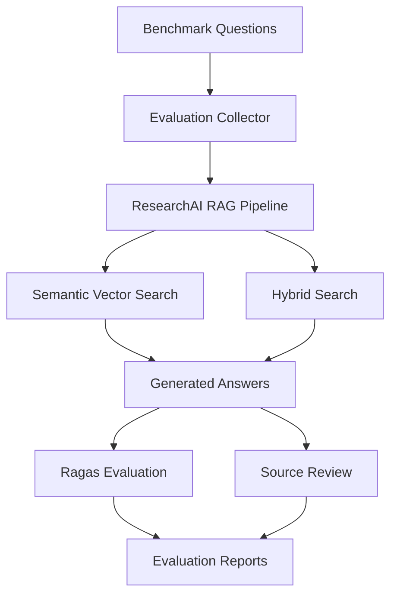

# Offline RAG Evaluation

ResearchAI includes a reproducible, offline evaluation framework built with **Ragas** to measure retrieval quality, answer generation, and citation reliability.

The evaluation framework uses the application's actual Hybrid RAG pipeline, allowing meaningful comparisons between semantic-only and hybrid retrieval strategies.

Evaluation runs independently of the production chatbot to avoid additional latency and unnecessary API costs during normal user interactions.

## Overview

The evaluation framework focuses on three main objectives:

- **Retrieval Quality:** Determine whether relevant evidence is successfully retrieved from research documents.
- **Answer Quality:** Evaluate the factual accuracy, relevance, and faithfulness of generated responses.
- **Source Reliability:** Verify whether generated claims are supported by the original research paper.

The framework combines automated Ragas metrics with source-based manual review.

## Evaluation Architecture



The collector executes the same retrieval and answer-generation components used by the application.

Semantic-only and hybrid retrieval share the same query embedding and source snapshot, helping maintain consistency during comparisons.

Generated answers are evaluated independently and are not inserted into user conversation history.

## Benchmark Dataset

The primary benchmark is located at:

`evaluation/datasets/rag_test_cases.json`

It contains **20 source-grounded questions**, including two unsupported questions, based on the published research paper *Lost in the Middle* (CC BY 4.0).

The benchmark includes:

- Questions answerable from the research paper
- Questions requiring precise supporting evidence
- Unsupported questions to test appropriate abstention
- Reference answers and source information
- Dataset and review provenance

References were checked against the PDF through assistant-assisted review. These checks are recorded as assistant reviews and should not be interpreted as independent human validation.

The original `benchmark_dataset.json` is a legacy scaffold and is not used by the current evaluation runner.

Additional dataset information is available in [Dataset Documentation](datasets/README.md).

## Evaluation Metrics

ResearchAI uses five Ragas metrics to evaluate retrieval and generation.

| Metric | Purpose |
|---|---|
| Faithfulness | Measures whether generated claims are supported by retrieved context |
| Answer Relevancy | Measures how relevant the generated response is to the question |
| Context Precision | Evaluates the relevance and ranking of retrieved evidence |
| Context Recall | Measures whether the retrieved evidence covers the information needed |
| Factual Correctness (F1) | Compares generated responses with reference answers |

### Evaluation Principles

- Metrics are calculated only when their required inputs are available.
- Missing or failed measurements are recorded with an explicit reason.
- Genuine zero scores are preserved rather than treated as errors.
- Unsupported questions receive separate abstention checks.
- Results include measurement coverage and applicable limitations.
- Automated metric scores are supplemented by source-based reviews.

Ragas does not guarantee factual correctness. Evaluation results are interpreted alongside the original research evidence.

## Evaluation Technology

| Component | Technology |
|---|---|
| Evaluation Framework | Ragas 0.2.15 |
| Retrieval Pipeline | MongoDB Atlas Vector Search, BM25, RRF |
| Embeddings | Voyage AI |
| Answer Generation | OpenRouter |
| Evaluation Judges | OpenRouter-compatible LLMs |
| Data Validation | Python, Pydantic |
| Reporting | JSON and Markdown |
| Testing | pytest |

The implementation uses Ragas `EvaluationDataset` and `evaluate()` with explicit provider adapters.

LLM judge requests are routed through OpenRouter, while answer-relevancy embeddings use Voyage AI.

Ragas evaluation is an optional dependency and is not required for serving normal chatbot requests.

## Installation

Run the following commands from the repository root.

Create a separate Python environment for evaluation:

```bash
python3 -m venv .venv-evaluation
source .venv-evaluation/bin/activate
```

Install the dependencies:

```bash
pip install -r backend/requirements.txt -r evaluation/requirements.txt
```

Configure the necessary API credentials and evaluation settings in `.env`.

External AI calls may consume provider credits.

## Running the Evaluation

Before starting, ensure that the benchmark PDF has been uploaded and successfully processed by ResearchAI.

Create a local bindings JSON file mapping the benchmark paper identifier `lost-in-middle-tacl-2024` to its actual MongoDB document ID.

Keep this file outside version control.

### 1. Validate the Benchmark

```bash
python -m evaluation.evaluate validate \
  --pdf /absolute/path/to/2024.tacl-1.9.pdf
```

This validates the benchmark against the source PDF before running paid evaluation operations.

### 2. Collect RAG Responses

```bash
python -m evaluation.evaluate collect \
  --bindings /absolute/path/to/bindings.json \
  --limit 20 \
  --live
```

The collector runs the application retrieval and answer-generation pipeline and stores the resulting evaluation artifacts.

### 3. Calculate Ragas Metrics

```bash
python -m evaluation.evaluate score \
  --collection evaluation/results/collection-RUN_ID.json \
  --live
```

Replace `RUN_ID` with the actual collection identifier.

The scoring process evaluates the saved responses without repeating answer generation.

### Alternative: Run the Complete Workflow

```bash
python -m evaluation.evaluate run \
  --bindings /absolute/path/to/bindings.json \
  --limit 20 \
  --live
```

This combines collection and scoring.

### Run a Small Evaluation

For a quick development test:

```bash
python -m evaluation.evaluate run \
  --bindings /absolute/path/to/bindings.json \
  --limit 2 \
  --live
```

You can also select a specific retrieval strategy using:

- `--strategy hybrid`
- `--strategy semantic`

Use `--sample-id lim_01` to evaluate a selected benchmark question.

## Manual Source Review

Automated metrics are supplemented by answer-level evidence review.

Generate a review template:

```bash
python -m evaluation.evaluate manual-template \
  --collection evaluation/results/collection-RUN_ID.json \
  --output /absolute/path/to/manual-review.json
```

After reviewing the generated answers against their supporting evidence, attach the completed review:

```bash
python -m evaluation.evaluate review \
  --report evaluation/results/evaluation-EVALUATION_ID.json \
  --manual /absolute/path/to/manual-review.json
```

The review process preserves existing metric scores and verifies that review records correspond to the original evaluation results.

Reviews must identify whether they were completed by a human or an AI assistant. Assistant-generated assessments are not presented as independent human approval.

## Research Assistant Evaluation

In addition to the primary benchmark, ResearchAI includes a separate dataset for evaluating conversational research-assistant behavior.

Dataset:

`evaluation/datasets/intent_test_cases.json`

This dataset includes **nine research-assistant test cases**, covering factual questions, research overviews, follow-up questions, analytical requests, and general-knowledge handling.

Validate the dataset:

```bash
python -m evaluation.evaluate validate \
  --dataset evaluation/datasets/intent_test_cases.json \
  --pdf /absolute/path/to/published-paper.pdf
```

Collect evaluation responses:

```bash
python -m evaluation.evaluate collect \
  --dataset evaluation/datasets/intent_test_cases.json \
  --history evaluation/datasets/intent_history.json \
  --bindings /absolute/path/to/bindings.json \
  --limit 9 \
  --live
```

The collected results can then be scored using the standard scoring command.

General-knowledge responses are checked for clear labeling and appropriate separation from document-grounded claims.

Follow-up questions are reviewed with their recorded conversation context because single-turn relevance metrics may not fully capture conversational intent.

## Evaluation Results

The latest documented evaluation report is available at:

[Final QA Evaluation Report — November 13, 2026](reports/2026-11-13-final-qa/README.md)

The nine-case paired evaluation recorded:

| Measurement | Result |
|---|---:|
| Research questions | 9 |
| Generated responses | 18 |
| Recorded Ragas metric values | 58 |
| Applicable metric skips | 30 |
| Metric execution errors | 2 |

The evaluation also identified remaining issues involving citation support and source attribution.

These results demonstrate that the evaluation workflow can execute and report quality measurements. They do not establish universal answer accuracy or prove that hybrid retrieval is consistently superior.

Detailed scores, source assessments, and limitations are maintained in the published reports.

## Testing

Run the deterministic evaluation tests from the repository root:

```bash
RAGAS_DO_NOT_TRACK=true python -m pytest \
  backend/tests/test_benchmark_dataset.py \
  backend/tests/test_evaluation_collection.py \
  backend/tests/test_evaluation_metrics.py \
  backend/tests/test_evaluation_judge.py \
  backend/tests/test_evaluation_report.py -q
```

These tests verify dataset validation, collection contracts, evaluation adapters, metric handling, and report generation.

Test fixture scores are not treated as measured benchmark results.

## Reproducibility and Data Handling

The evaluation workflow records relevant configuration and source information to support reproducible comparisons.

Important safeguards include:

- Validating source PDF identity and processing generation
- Preserving dataset and configuration references
- Keeping semantic and hybrid comparison inputs consistent
- Recording failures without fabricating answers or scores
- Separating local evaluation artifacts from published reports
- Disabling anonymous Ragas telemetry during evaluation

Local evaluation outputs are stored under `evaluation/results/` and excluded from version control because they may contain document passages or other sensitive research content.

Only deliberately reviewed, shareable reports should be published under `evaluation/reports/`.

## Current Limitations

- Ragas scores depend on evaluator models and benchmark quality.
- A small benchmark cannot represent all academic research domains.
- Reference-based metrics require suitable ground-truth answers.
- Follow-up questions may be underestimated by single-turn relevancy metrics.
- Strict citation validation may reject otherwise useful answers.
- Some evaluation results contain metric errors or incomplete citation support.
- Paid LLM evaluation depends on available API credits and provider reliability.

Future improvements include larger multi-domain benchmarks, retrieval ablation studies, improved citation evaluation, and more extensive independent human review.

## Documentation

- [Evaluation Methodology](../docs/rag-evaluation.md)
- [Benchmark Dataset](datasets/README.md)
- [Source Review Checklist](datasets/MANUAL_REVIEW.md)
- [Evaluation Reports](reports/README.md)
- [Hybrid RAG Architecture](../docs/hybrid-rag.md)

---

**ResearchAI Evaluation — Measuring retrieval relevance, answer faithfulness, and source reliability through reproducible experiments.**
