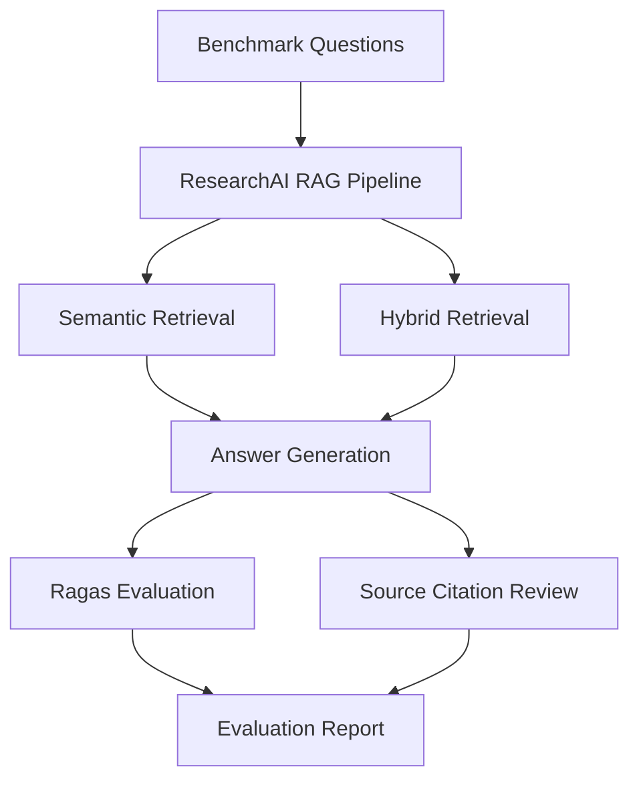

# ResearchAI — RAG Evaluation Report

**Evaluation Date:** November 13, 2026
**Evaluation Framework:** Ragas 0.2.15
**Evaluation Status:** Partial — 2 metric errors
**Benchmark:** Research Assistant Intent Evaluation

## 1. Overview

This report presents an offline evaluation of ResearchAI's Retrieval-Augmented Generation (RAG) pipeline.

The evaluation examines retrieval quality, answer relevance, factual correctness, and source attribution using real responses generated by the configured application.

Two retrieval strategies were evaluated:

- **Hybrid Retrieval:** Semantic vector search combined with BM25 keyword retrieval using Reciprocal Rank Fusion (RRF).
- **Semantic Retrieval:** Dense vector similarity search without keyword fusion.

The objective is to identify retrieval and answer-generation strengths and limitations through reproducible measurements.

These results represent a controlled benchmark, not a guarantee of overall research-answer accuracy.

---

## 2. Evaluation Configuration

| Component | Configuration |
|---|---|
| Source Paper | *Lost in the Middle: How Language Models Use Long Contexts* |
| Evaluation Dataset | 9 research-assistant questions |
| Retrieval Strategies | Hybrid RAG and Semantic Search |
| Generated Responses | 18 |
| Generation Model | `openai/gpt-5.6-luna` |
| Evaluation Judge | `meta-llama/llama-3.3-70b-instruct` |
| Embedding Model | `voyage-4-lite` |
| Embedding Dimensions | 1024 |
| Evaluation Framework | Ragas 0.2.15 |
| Chunk Size | 1200 characters |
| Chunk Overlap | 150 characters |
| Source Chunks | 105 |
| Source PDF Pages | 17 |

**Source:** Nelson F. Liu et al. (2024), *Lost in the Middle: How Language Models Use Long Contexts*, Transactions of the Association for Computational Linguistics, Volume 12.

- [Published Research Paper](https://aclanthology.org/2024.tacl-1.9/)
- [Original PDF](https://aclanthology.org/2024.tacl-1.9.pdf)
- DOI: `10.1162/tacl_a_00638`
- License: CC BY 4.0

The evaluation uses public research content. No private uploaded papers or application conversations are included in the published results.

---

## 3. Evaluation Workflow



Both retrieval strategies use the same source document and compatible query/candidate snapshots.

The evaluation separates automated Ragas scoring from source-based review.

For overview questions, both strategies reused the same saved structured-summary context. Therefore, those cases evaluate answer behavior rather than differences in retrieval ranking.

---

## 4. Evaluation Results

The benchmark produced **18 real responses** across nine questions and two retrieval strategies.

### Execution Summary

| Measurement | Result |
|---|---:|
| Benchmark Questions | 9 |
| Retrieval Strategies | 2 |
| Generated Responses | 18 |
| Generation Failures | 0 |
| Recorded Metric Values | 58 |
| Applicable Metric Skips | 30 |
| Metric Errors | 2 |
| Assistant-Reviewed Responses | 18 |

The two metric errors occurred in context-recall evaluation for overview questions.

These values remain unavailable rather than being replaced with estimated or zero scores.

### Ragas Metric Comparison

<text color="secondary">Mean scores for applicable cases. Higher is generally better.</text>

| Metric | Hybrid RAG | Semantic Search | Scored Cases per Strategy |
|---|---:|---:|---:|
| Faithfulness | **0.9658** | 0.9465 | 6 |
| Answer Relevancy | **0.6161** | 0.5451 | 6 |
| Context Precision | **0.9641** | 0.8433 | 6 |
| Context Recall | 0.9333 | 0.9333 | 5 (1 error) |
| Factual Correctness | **0.6167** | 0.5717 | 6 |

The measured means were higher for Hybrid RAG on four metrics, while Context Recall was equal for the successfully scored cases.

However, the benchmark is too small to establish that Hybrid RAG is generally superior.

These results also should not be interpreted as an overall system accuracy percentage.

---

## 5. Metric Interpretation

### Faithfulness

Measures whether generated statements are supported by the retrieved context.

- Hybrid RAG: **0.9658**
- Semantic Search: **0.9465**

Both approaches achieved relatively high measured faithfulness on applicable cases.

However, high faithfulness does not guarantee that each individual claim is supported by its attached citation.

### Answer Relevancy

Measures the relevance of generated responses to user questions.

- Hybrid RAG: **0.6161**
- Semantic Search: **0.5451**

Hybrid RAG achieved the higher mean in this run, although both results indicate opportunities to improve answer focus.

### Context Precision

Evaluates how effectively retrieved passages prioritize relevant evidence.

- Hybrid RAG: **0.9641**
- Semantic Search: **0.8433**

Hybrid retrieval achieved a higher mean on the scored cases.

This result is consistent with the potential benefit of combining semantic and keyword retrieval, but does not independently establish a general retrieval advantage.

### Context Recall

Evaluates whether retrieved evidence covers information required for the reference answer.

- Hybrid RAG: **0.9333**
- Semantic Search: **0.9333**

The successfully scored cases produced identical means.

One overview question per strategy returned an invalid or missing metric result.

### Factual Correctness

Compares generated responses with curated reference answers.

- Hybrid RAG: **0.6167**
- Semantic Search: **0.5717**

Hybrid retrieval achieved the higher mean, but both strategies require further improvement in answer completeness and correctness.

---

## 6. Source Citation Review

All 18 generated responses underwent systematic assistant-based source review.

Deterministic citation checks confirmed source identifiers, page references, and extracted quotation identities.

However, manual-style source assessment identified **seven responses with incomplete claim-to-citation support**.

### Identified Issues

| Category | Finding |
|---|---|
| Research Overviews | Some multi-fact descriptions lacked complete supporting citations |
| Analytical Questions | Certain interpretations were stronger than the evidence provided |
| Comparison Questions | Some explanations were attributed to the paper without sufficient source support |
| Mixed Questions | Some quantitative or multi-task claims lacked complete citations |
| Saved Summary | Broad key-result statements were not fully supported by individual selected quotations |

Three responses also failed the review's answer-quality or attribution criteria.

These issues highlight an important distinction:

**A valid source quotation does not necessarily prove that a generated claim logically follows from that quotation.**

The evaluation therefore treats source identity validation and scientific claim correctness as separate quality concerns.

All review records are attributed to an AI assistant. Independent human review is not claimed.

---

## 7. Engineering Findings

The evaluation provided several useful observations.

### Hybrid Retrieval

Hybrid RAG achieved higher mean scores for Context Precision, Answer Relevancy, Faithfulness, and Factual Correctness within the measured sample.

This suggests areas worth investigating through larger evaluations.

### Citation Validation

Deterministic citation checks successfully verified source references, but claim-to-evidence completeness remains an important limitation.

Future evaluation should assess whether each generated claim is adequately supported, not only whether its citation exists.

### Saved Summary Reuse

Both overview evaluations successfully reused the completed `grounded-summary-v2` summary.

The corresponding traces recorded:

```text
summary_reused=true
context_strategy=saved_summary
```

This confirms that the evaluation exercised the persisted-summary reuse path.

Because earlier evaluations used section-based fallback and language-model generation is variable, direct before-and-after mean-score comparisons would not be reliable.

### Evaluation Coverage

Unsupported questions and general-knowledge requests were assessed through appropriate abstention and labeling checks.

Reference-dependent metrics were not applied where their required inputs were unavailable.

This avoids misleading numerical results for inapplicable cases.

---

## 8. Reproducibility

The benchmark was executed against the configured ResearchAI pipeline at:

**Commit:** `146aed66415b6b428ff07c51cda6db6cb27c2055`

### Source Identity

**SHA-256:**

```text
f37f6fabe0fe0d8c73b67579cd115dbf14e282cfb7b7af655ae8109638402c9b
```

The source identity, chunk configuration, selected contexts, prompt information, and individual generated responses are retained in the evaluation artifacts.

### Evaluation Budgets

| Setting | Value |
|---|---:|
| Maximum LLM Requests | 350 |
| Maximum Embedding Inputs | 80 |
| Actual Scoring LLM Requests | 278 |
| Actual Scoring Embedding Inputs | 48 |

Collection and answer-generation requests are additional to the scoring usage shown above.

### Reproduction

Follow the [Offline RAG Evaluation Guide](../../README.md) using the same source PDF, document binding, dataset, and curated history.

For the intent benchmark, use the commands documented in [Research Assistant Intent Checks](../../README.md#research-assistant-evaluation).

Evaluation runs may consume API credits and can produce different results because of model variability.

Generated evaluation artifacts should be retained separately rather than overwriting previous benchmark results.

---

## 9. Evaluation Limitations

The results are subject to several limitations:

- The benchmark contains only nine questions from one published research paper.
- A single evaluator model was used.
- Two context-recall measurements failed.
- Some benchmark questions use shared summary context rather than independent retrieval rankings.
- Generated responses vary with model behavior.
- High automated scores do not guarantee complete citation support.
- Assistant-based source review is not equivalent to independent human validation.
- The experiment does not establish universal research-answer accuracy or general Hybrid RAG superiority.

Further evaluation across more papers, question types, and evaluator configurations is required before drawing broader conclusions.

---

## 10. Future Improvements

Recommended next steps include:

1. Expand benchmark coverage across multiple research domains.
2. Improve claim-level citation completeness.
3. Strengthen evidence selection for multi-fact answers.
4. Add independent human source reviews.
5. Investigate answer relevancy and factual correctness failures.
6. Compare retrieval strategies with larger, controlled datasets.
7. Improve robustness of metric execution and error reporting.

---

## 11. Evaluation Artifacts

The complete evaluation outputs are available below:

- [Full Evaluation Report](evaluation-e03061c486b34739818cdbfe14689146.md)
- [Structured Results and Traces](evaluation-e03061c486b34739818cdbfe14689146.json)
- [Evaluation Methodology](../../README.md)
- [Previous Intent Evaluation](../2026-11-12-assistant/README.md)

The structured artifacts contain the individual questions, responses, measured scores, source references, errors, and assistant review findings.

---

## Conclusion

The November 13, 2026 evaluation demonstrated that ResearchAI's offline benchmarking workflow can collect real responses, measure applicable Ragas metrics, and expose answer-quality and citation-support weaknesses.

Hybrid RAG achieved higher mean scores on four measured metrics within this limited benchmark. Nevertheless, citation completeness and scientific answer reliability require additional work.

**Overall outcome:** Reproducible evaluation completed with partial metric coverage, documented source-review findings, and clearly identified opportunities for improvement.
